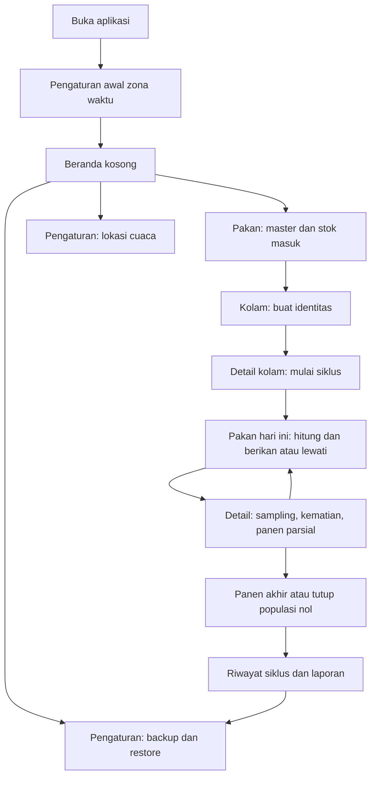

# Alur Sistem FishCare

Tanggal: 13 Oktober 2026. Irisan M4 telah dibuat pada sumber; rancangan penuh lainnya tetap provisional.

## Keputusan lokasi cuaca — 14 Oktober 2026

FR-08, AT-21/41–45. [TAHAP_CUACA_LOKASI.md](TAHAP_CUACA_LOKASI.md) adalah status implementasi/verifikasi terbaru. Keputusan ini menggantikan alur pemilihan manual saja; tidak menyatakan seluruh usulan PRD telah disepakati.

Beranda membuka lokasi usaha tersimpan/cache dan boleh memperbarui cuaca dari koordinat itu. **Tidak meminta izin/membaca lokasi HP.** Ambil lokasi saat ini → izin foreground jika perlu → fix sekali (batas30detik setelah izin) → calon lokasi dan koordinat/perkiraan/akurasi → Simpan sebagai lokasi usaha → dialog konfirmasi → commit atomik satu lokasi global → buang respons cuaca lama → cache/API lokasi baru. Android24–29 memakai permintaan single-update yang dibersihkan setelah fix/timeout/cancel; Android30+ memakai getCurrentLocation dengan cancellation. Tidak ada service/polling/background lokasi.

GPS mati/izin ditolak/gagal: pesan, Coba lagi pengambilan lokasi atau Pilih lokasi manual. Pilih manual → Cari kota/kecamatan → nama/wilayah/koordinat → calon → konfirmasi yang sama. Batalkan pengambilan/calonnya, Batal dialog atau Kembali dari pencarian tidak mengganti lokasi lama. Berpindah halaman/background menghentikan fix dan mengabaikan callback terlambat. Setelah konfirmasi, mengikuti pengguna yang berpindah dilarang; Muat ulang cuaca hanya memakai lokasi usaha tersimpan.

Simpan pengganti dalam transaksi: jika gagal, rollback menjaga lokasi lama; jika respons teknis belum pasti, baca lokasi tersimpan untuk menentukan hasil. Cache keyed koordinat; nomor request memisahkan hasil lama/baru; respons lama tidak ditulis sebagai cache baru atau ditampilkan sebagai cuaca baru. Kegagalan API tidak menghalangi lokal, unit/null/waktu data dan status cache tetap jujur. Ini satu lokasi untuk seluruh kolam, bukan lokasi per kolam.

## Pembaruan M5 — laporan dan penyegaran

FR-07, AT-18/19/37–40. M4 belum terverifikasi HP; pengguna menunda pemasangan/uji sampai kandidat M4+M5. Status dan hasil ada di [M5_IMPLEMENTASI.md](M5_IMPLEMENTASI.md). Bagian milestone sebelumnya tetap riwayat.

Laporan → pilih mulai/akhir inklusif dan satu/semua kolam (arsip ikut) → Terapkan filter → snapshot database → lima total: gram aktual, biaya snapshot, mati, panen parsial+akhir, nilai snapshot. Mulai>akhir atau tanggal tidak valid ditolak. Total bukan kondisi terkini; canceled tidak masuk total. Klik metrik membuka pendukung jenis terkait (batal tetap berlabel) → Detail ID/snapshot/alasan; tanggal/kolam tetap saat kembali. Riwayat periode membuka seluruh kegiatan termasuk sampling/close tanpa menambah metrik fiktif.

Kondisi saat ini hanya siklus aktif mengikuti kolam; Seluruh siklus total sah seluruh tanggal tiap siklus mengikuti kolam. Keduanya berlabel **tidak dibatasi rentang periode**, bukan mencampur angka ke Transaksi periode. Beranda memakai snapshot dan rumus total yang sama untuk hari ini dalam zona usaha.

Commit atau batal melalui repository menerbitkan sinyal setelah transaksi selesai. Layar laporan/pendukung/beranda yang terbuka membaca ulang, layar yang baru ditampilkan memuat data terbaru. Filter laporan tetap saat pindah tab. ID pemulihan yang ditutup juga memicu pembacaan ulang. Loading membersihkan angka lama; error menawarkan retry tanpa menampilkan0 palsu; kosong menampilkan label dan total sah0. Nomor permintaan memastikan hasil/error filter lama tidak menimpa filter baru. Semua lokal/offline; Kembali tetap tersedia. Tidak membuat FCR, selisih pendapatan-biaya atau keuntungan bersih.

## Pembaruan M4 — keputusan pengguna

Bagian ini menggantikan batas pembatalan dan status implementasi M3 di bawah. Pengguna mengonfirmasi seluruh percobaan manual gabungan M2+M3 berhasil tanpa kendala; **hasil pengguna**, bukan analyze/test/build agen. M4 belum diuji HP. [M4_IMPLEMENTASI.md](M4_IMPLEMENTASI.md) mencatat verifikasi. Usulan lain tetap usulan.

FR-05/06, AT-08/11–17/25/31–36: Detail kolam → Sampling/Kematian/Panen parsial/Panen akhir → form scrollable → ringkasan → konfirmasi → niat ID persisten → transaksi → muat ulang kondisi dan riwayat. Kembali sebelum konfirmasi tidak menulis kegiatan. Semua lokal/offline; loading/error tidak menahan navigasi. Error validasi rollback bisnis; error teknis diarahkan ke pemulihan ID sama, tanpa retry otomatis.

| Kegiatan | Validasi dalam transaksi | Perubahan atomik |
|---|---|---|
| Sampling | Sampel bulat>0 dan<=populasi; bobot>0 maksimal2desimal; satu sah/hari | Snapshot sebelum/sesudah; bobot terkini berubah, populasi tetap; pending dihitung ulang; hasil ID |
| Kematian | Jumlah>0 dan<=populasi terkini | Populasi berkurang; seluruh sisa boleh mati; kebutuhan/pending0 bila populasi0; hasil ID |
| Parsial | Jumlah>0 dan<populasi; bobot/harga positif | Populasi berkurang; snapshot jumlah/bobot/harga/nilai half-up; pending ulang; hasil ID |
| Akhir | Read-only seluruh sisa; bobot/harga wajib hanya bila>0; pratinjau stale ditolak | Satu snapshot panen bila ada; sisa0 hanya close tanpa panen/nilai. Closed, pending berhenti, hasil ID dan riwayat utuh |

Pembatalan lewat Riwayat kegiatan: hanya sah terakhir lintas pemberian/sampling/kematian/parsial dalam siklus aktif hari ini. Urutan commit bersama; alasan wajib; validasi ulang transaksi. Rate/jam/Lewati bukan penghalang. Pemberian memulihkan stok tepat lewat reversal, sampling memulihkan bobot, kematian/parsial memulihkan populasi. Catatan batal tetap; pending dihitung ulang dengan rate terkini; given/skipped tetap. Kegiatan dengan lanjutan ditolak jelas. Akhir/siklus selesai tidak dapat batal. Setelah batal, kegiatan sah terakhir berikutnya dapat ditinjau dengan aturan sama.

Setelah close, detail tetap menampilkan riwayat lama, tanpa kegiatan untuk closed; boleh mulai siklus baru. Tidak membuat slot baru pada closed. Konfirmasi panen menampilkan jumlah/bobot/biomassa/harga/nilai. Jika populasi berubah sejak ringkasan, tolak utuh dan tinjau ulang, bukan mengubah jumlah diam-diam.

## Riwayat rancangan M0–M3

Acuan: [PRD v0.1](PRD_FishCare_Baru_v0.1.md), [rancangan database](RANCANGAN_DATABASE.md), dan [wireframe](WIREFRAME.md). PRD tetap menjadi sumber kebutuhan. Ketentuan bagian 14 PRD dipakai sebagai baseline sementara, bukan persetujuan pengguna atas setiap usulan. Android, satu pengguna, beberapa kolam, data lokal, dan API cuaca merupakan kebutuhan terkonfirmasi. Tidak ada acuan rate budidaya yang ditambahkan.

RV-01–RV-03 telah diputuskan pengguna untuk M3: koreksi selisih stok, pemberian sah terakhir boleh batal setelah rate/jam/Lewati, dan niat persisten sebelum bisnis. Runtime masih perlu verifikasi; ketergantungan sampling/populasi telah diputuskan pengguna M4 di bagian pembaruan. Status terbaru ada di [README](../README.md).

## Keputusan M3 yang menggantikan baseline koreksi sebelumnya

Keputusan pengguna M3 telah dicatat pada PRD bagian 4/5 dan AT-29–31. Bagian rancangan di bawah yang masih menyebut stok masuk tidak dapat dikoreksi, rate/jam/Lewati sebagai penghalang, atau operation hanya hasil commit merupakan baseline historis yang digantikan aturan ini:

- Stok bersama memakai ledger. Koreksi stok masuk menyimpan asal, jumlah efektif lama/baru, alasan dan pergerakan selisih. Baru harus >=0 dan saldo akhir >=0; pratinjau lama yang stale ditolak. Asal tidak dihapus.
- Pemberian sah terakhir hari ini dalam siklus aktif boleh dibatalkan setelah rate/jam/Lewati. Stok dipulihkan tepat lewat reversal, catatan keluar asli tetap dijumlahkan, snapshot lama tidak diubah. M4 memperluas kandidat menjadi kegiatan sah terakhir lintas jenis; lihat bagian pembaruan M4.
- ID niat/payload disimpan sebelum transaksi bisnis. Hasil commit ditulis bersama perubahan bisnis. Setelah restart, baca ID yang sama dan periksa hasil sebelum menawarkan retry eksplisit; tidak memakai ID baru otomatis.
- Lewati membagi ulang sisa hanya ke pending. Jam hari ini tetap, template jam baru tetap besok. Tidak membuat pemberian nol.

Rincian skema versi3, transaksi, UI pemulihan dan uji ada di [M3_IMPLEMENTASI.md](M3_IMPLEMENTASI.md). Uji manual gabungan M2+M3 kemudian dikonfirmasi berhasil oleh pengguna; verifikasi standar tetap sesuai bukti. Pernyataan lama adalah riwayat rancangan, bukan aturan implementasi M3.

## 1. Peta perjalanan dan halaman



Empat tab utama: Beranda, Kolam, Pakan, Laporan. Pengaturan dibuka dari Beranda. Detail kolam membuka kegiatan dan riwayat; kartu pakan Beranda membuka slot yang sama dengan tab Pakan, bukan catatan baru. Ringkasan Laporan membuka transaksi pendukung dengan filter tetap. Siklus selesai hanya membuka riwayat; kolam tidak diarsipkan dapat memulai siklus berikutnya.

## 2. Aturan lintas alur

- Semua pencatatan inti berfungsi offline. Kegagalan cuaca hanya mengubah kartu cuaca.
- Tanggal kegiatan adalah hari ini dalam zona usaha. Timestamp kejadian disimpan terpisah. Zona default perangkat dikonfirmasi pada awal penggunaan, lalu dikunci setelah transaksi pertama; definisi transaksi pertama masih O-06.
- Input ikan dan gram pakan bulat; bobot gram serta rate persen maksimal dua desimal; rupiah bulat. Tidak ada pemisah ribuan pada input. `1500` sah, `1,5` hanya sah pada field desimal, `1.500` ditolak. Kosong, negatif, NaN/infinity, overflow, atau format campuran ditolak dekat field, tanpa menggantinya dengan nol (AT-03, AT-27).
- Form memeriksa lebih awal; penyimpanan memeriksa ulang tanggal, status siklus, stok/populasi, keunikan, serta seluruh hasil perhitungan dalam satu transaksi. Gagal berarti tidak ada perubahan sebagian (AT-06–07, AT-11, AT-25).
- Satu tindakan simpan mempunyai ID operasi tetap. Ketukan ulang/retry memakai ID yang sama; hasil yang belum pasti diperiksa dahulu. ID baru hanya untuk tindakan baru. Tombol dinonaktifkan selama simpan, tetapi keunikan penyimpanan menjadi pelindung utama (AT-05, AT-13).
- Batal sebelum simpan membuang draft setelah konfirmasi jika ada perubahan. Kembali saat operasi sudah berjalan tidak menjanjikan rollback; hasil diperiksa melalui ID operasi. Pembatalan transaksi tersimpan hanya lewat aturan koreksi bagian 7.
- Setelah commit, halaman terkait dimuat ulang saat ditampilkan. Respons lama untuk halaman/kolam/filter berbeda diabaikan. Gagal muat ulang setelah commit ditulis “Tersimpan, tampilan belum diperbarui — muat ulang”, bukan menawarkan simpan baru (AT-19).
- Tidak ada penghapusan permanen riwayat, pengisian tanggal mundur, atau pencatatan otomatis hari yang terlewat.

## 3. Penggunaan pertama, master, dan mulai siklus

### 3.1 Penggunaan pertama (FR-01–04, FR-08; AT-01)

1. Muat database lokal dan pengaturan. Jika belum ada, tampilkan zona waktu default perangkat untuk dikonfirmasi, tanpa data contoh.
2. Beranda menampilkan “Belum ada kolam/siklus”, “Belum ada pakan”, “Lokasi belum dipilih”, dan “Belum pernah backup”. Pengaturan lokasi boleh ditunda.
3. Tombol Buat pakan membuka form master; lalu Stok masuk. Buat kolam dan Mulai siklus tetap tersedia tanpa internet.
4. Database tidak dapat dibuka: hentikan pencatatan dan tampilkan Coba lagi; jangan diam-diam membuat database kosong untuk menggantikan data lama. Migrasi gagal mempertahankan data lama.

### 3.2 Pakan dan stok (FR-03; AT-04, AT-06–07, AT-15)

| Tindakan | Input dan validasi | Perubahan setelah simpan | Batal/gagal dan dampak laporan |
|---|---|---|---|
| Buat pakan | Nama unik, harga rupiah/kg; harga >0 sebelum dipakai | Master baru; stok nol jika belum ada stok masuk | Batal tidak membuat master; stok bukan angka yang dapat ditimpa |
| Stok awal/masuk | Pakan, gram >0, hari ini; ringkasan pakan/jumlah | Pergerakan masuk dan saldo bertambah atomik | Asal tidak dihapus; M3 mengizinkan koreksi selisih beralasan, jumlah efektif/saldo tidak boleh negatif |
| Koreksi stok masuk | Asal, jumlah lama yang ditinjau, baru >=0, alasan wajib | Simpan lama/baru/alasan + ledger selisih + hasil ID tindakan atomik | Pratinjau stale, jumlah/saldo negatif, atau tidak ada perubahan ditolak; asal dan seluruh koreksi tetap |
| Ubah nama/harga | Nama unik; harga >0 | Master berubah; harga hanya untuk pemberian berikutnya | Snapshot lama tetap; tidak mengubah nilai laporan lama |
| Arsip pakan | Tidak dipakai siklus aktif | Master tersembunyi dari pilihan baru, riwayat tetap | Tolak jika masih dipakai siklus aktif |

Baseline desain: nama pakan dinormalisasi seperti nama kolam; master baru meminta harga positif, stok masuk menjadi form terpisah agar tidak ada stok tanpa ledger. Ini pilihan desain, bukan tambahan metode biaya pembelian.

### 3.3 Kolam dan siklus (FR-01–02; AT-01–03, AT-10, AT-27)

- Buat/ubah kolam: nama wajib unik setelah trim dan normalisasi kapitalisasi; catatan dan ukuran opsional. Ukuran hanya informasi, tidak masuk rumus (satuan belum ditentukan, O-08).
- Arsip: tolak jika ada siklus aktif. Riwayat dan pilihan kolam pada laporan tetap dapat menemukan kolam arsip. Pemulihan arsip belum ditentukan PRD (O-08).
- Mulai siklus: pilih kolam tidak arsip tanpa siklus aktif, label jenis ikan, jumlah awal >0, bobot >0, master pakan tidak arsip dengan harga >0, rate >0 sampai 100%, serta 1–6 jam unik. Stok nol boleh memulai siklus; pemberian tetap menuntut stok cukup.
- Ringkasan menampilkan tanggal hari ini, jumlah/bobot awal, pakan, rate, jam, dan kebutuhan. Rate mengikuti acuan pengguna/dosen; aplikasi tidak menyarankan nilainya.
- Simpan atomik: siklus, rate awal, versi jam awal, dan slot hari ini. Jika gagal, semuanya batal. Jumlah/bobot awal, jenis ikan, serta pakan terkunci setelah mulai.

## 4. Hari aktif, kebutuhan, dan pemberian

### 4.1 Sumber perhitungan bersama (FR-04; AT-02–03, AT-08–09, AT-15, AT-28)

```text
populasi = awal − kematian sah − panen parsial sah − panen akhir sah
bobot = sampling sah terakhir, atau bobot awal
biomassa gram = populasi × bobot gram (tanpa pembulatan antara)
kebutuhan = bulat_terdekat(biomassa × rate / 100)
aktual hari ini = jumlah pemberian sah pada tanggal usaha hari ini
sisa = max(0, kebutuhan terbaru − aktual hari ini)
kelebihan = max(0, aktual hari ini − kebutuhan terbaru)
```

Pembulatan tepat setengah menggunakan half-up: naik, sesuai keputusan pengguna M2 pada PRD bagian 4 (O-02 pembulatan selesai). Pembagian gram bulat: bagi merata ke slot menunggu berurutan jam, sisanya satu gram per slot dari yang paling awal. 301 g menjadi 151 + 150 g. Data rate/bobot hilang atau tidak sah: “Belum bisa dihitung”, tanpa porsi nol palsu. Kebutuhan nol yang berasal dari data valid berbeda dari data tidak lengkap.

Contoh PRD: 100 ikan ×100 g ×3% =300 g; dua slot 150+150. Setelah diberikan 150 g lalu sampling 120 g, kebutuhan 360 g, sisa slot 210 g. Jika kebutuhan terbaru turun menjadi 120 g, aktual 150 g tetap, sisa nol dan kelebihan 30 g; tidak ada pengembalian stok otomatis.

### 4.2 Jam besok berbeda dari porsi hari ini (FR-04; AT-10, AT-26)

| Perubahan | Waktu berlaku | Data yang boleh berubah |
|---|---|---|
| Ubah 1–6 jam | Besok menurut zona usaha | Versi template efektif besok; perubahan ulang hari yang sama mengganti versi besok |
| Sampling/rate/populasi/pemberian aktual/pembatalan | Setelah commit hari ini | Kebutuhan terbaru dan porsi slot hari ini yang masih menunggu |

Sebelum menulis template besok, pastikan slot hari ini berasal dari template yang efektif hari ini, walaupun halaman Pakan belum dibuka. Jam hari ini tidak bergeser. Slot diberikan/dilewati tidak mendapat porsi ulang. Perubahan template besok tidak menjadi pembagi untuk sisa hari ini.

Saat pergantian hari atau kembali dari background: tutup draft tanggal lama, baca tanggal usaha lagi, gunakan versi efektif terbaru dengan tanggal <= hari baru, dan buat slot hari baru secara idempoten. Cek lagi tanggal saat simpan agar draft kemarin tidak tercatat hari ini. Tidak mengisi transaksi untuk hari aplikasi tidak dibuka. Slot lampau yang menunggu tetap berlabel belum diberikan, bukan diberikan otomatis. Jam yang sudah lewat bukan alasan mencatat pemberian otomatis.

### 4.3 Berikan atau lewati (FR-03–04; AT-04–07, AT-15, AT-28)

1. Pilih slot menunggu pada siklus aktif hari ini. Tampilkan porsi rencana, sisa kebutuhan, saldo stok bersama, harga tercatat.
2. Isi aktual gram bulat >0. Porsi boleh berbeda dari rencana. Lebih besar dari sisa meminta konfirmasi tambahan. Slot porsi nol tetap menonaktifkan Berikan sesuai PRD; gunakan Lewati (ketegangan aturan masih O-04).
3. Ringkasan: aktual, pakan, harga snapshot/kg, biaya pembulatan terdekat(aktual × harga /1000), dan saldo sesudah.
4. Dalam transaksi, baca ulang kondisi terkini. Jika harga/perhitungan/populasi berbeda dari ringkasan, minta pengguna meninjau ringkasan baru sebelum commit. Stok tidak cukup: tolak seluruh perubahan; tawarkan kembali mengubah aktual atau buka Stok masuk, tanpa mencatat kekurangannya sebagai sudah diberikan.
5. Commit pemberian + snapshot + pergerakan keluar + status diberikan + hitung ulang slot menunggu. 150 g pada Rp10.000/kg menghasilkan biaya Rp1.500 dan stok turun tepat 150 g.
6. Lewati tidak memotong stok atau membuat transaksi pemberian nol. Slot menjadi dilewati. Keputusan O-03 M3: sisa dibagi ulang segera hanya pada slot menunggu.

Jika tidak ada slot menunggu dan masih ada sisa, tampilkan “Sisa belum diberikan”. Tidak membuat slot tambahan. Jika populasi nol, Berikan berhenti tersedia; pengguna diarahkan menutup siklus.

## 5. Sampling, kematian, dan panen parsial

FR-05; AT-08–09, AT-11–12, AT-15, AT-17, AT-27.

| Kegiatan | Validasi dan ringkasan | Perubahan atomik | Pembatalan |
|---|---|---|---|
| Sampling | Jumlah sampel bulat >0 <=populasi; bobot >0 dua desimal; maksimal satu sampling sah per tanggal | Simpan sampling; bobot efektif terbaru berubah; populasi tetap; porsi menunggu dihitung ulang | Jika memenuhi batas koreksi, bobot kembali ke sampling sah sebelumnya/awal |
| Kematian | Jumlah bulat >0 <=populasi; tampilkan sisa ikan | Simpan pengurangan; hitung populasi dan porsi menunggu | Pembatalan terakhir memulihkan jumlah ikan |
| Panen parsial | Jumlah >0 <populasi; bobot panen >0, harga jual/kg >0; tampilkan biomassa/nilai | Simpan jumlah, bobot/harga/nilai snapshot; populasi berkurang; porsi menunggu berubah | Pembatalan terakhir memulihkan populasi; nilai lama tetap sebagai batal |

Bobot panen tidak otomatis menjadi bobot sampling bagi ikan yang tersisa. Nilai panen = pembulatan terdekat(jumlah × bobot panen gram × harga/kg /1000). Kematian menambah total ikan mati, panen menambah jumlah/nilai panen; sampling tidak menjadi pengurangan atau pendapatan. Gagal/batal sebelum simpan tidak mengubah apa pun. Kematian seluruh sisa diperbolehkan; tidak membuat panen fiktif.

## 6. Panen akhir dan siklus berikutnya

FR-06; AT-12–14, AT-25.

1. Baca sisa populasi. Jika >0, jumlah panen seluruh sisa ditampilkan read-only; pengguna wajib mengisi bobot panen >0 serta harga/kg >0. Selisih harus diperbaiki melalui kegiatan sah, bukan mengedit jumlah akhir.
2. Tampilkan konfirmasi jumlah, biomassa, harga, nilai, dan akibat siklus ditutup. Jika populasi nol, tampilkan “Tutup tanpa panen”, tanpa field pendapatan atau catatan panen.
3. Baca ulang populasi dalam transaksi. Jika berubah sejak konfirmasi, hentikan commit dan tampilkan ringkasan baru. Commit sekaligus: panen akhir bila ada, siklus selesai, dan hentikan slot menunggu (usulan pemetaan status dilewati dengan alasan penutupan, O-07).
4. Ketukan ulang memakai ID operasi yang sama dan mendapatkan hasil sebelumnya; permintaan baru pada siklus selesai ditolak. Penutupan tidak dapat dibatalkan.
5. Detail menjadi riwayat read-only, laporan diperbarui, kolam boleh diarsipkan atau memulai siklus berikutnya. Riwayat pemberian/panen sebelumnya tetap utuh.

## 7. Riwayat dan koreksi

FR-04–07; AT-16–17. Baseline pembatasan PRD bagian 4/14 belum dibekukan.

- Detail transaksi menampilkan tanggal, input/snapshot, status sah/batal, hubungan pembatalan, alasan, dan apakah dapat dibatalkan.
- Pada M4 hanya kegiatan sah terakhir lintas pemberian/sampling/kematian/panen parsial dalam siklus aktif pada hari yang sama menjadi kandidat. Rate/jam/Lewati tidak menghalangi. Panen akhir/siklus selesai tidak dapat dibatalkan; validasi ulang dalam transaksi.
- Tombol Batalkan membuka alasan wajib dan akibat: stok/populasi/bobot yang dipulihkan. Validasi kelayakan diulang dalam transaksi, bukan hanya lewat visibilitas tombol.
- Pembatalan pemberian: tandai batal, tambahkan pergerakan balik sebesar aktual lama, slot kembali menunggu, hitung ulang porsi. Snapshot dan pergerakan keluar asli tetap utuh. Jangan membatalkan pergerakan keluar sekaligus menambah balik karena akan menggandakan pengembalian.
- Pembatalan sampling/pengurangan: tandai batal, hitung kondisi dari catatan sah, hitung ulang porsi menunggu. Simpan hubungan ke asal dan alasan; tidak hapus catatan.
- Penolakan pemberian bukan yang terakhir sah, hari lampau, siklus selesai atau penutupan tidak mengubah data sebagian. Stok masuk dikoreksi melalui selisih, bukan batal/hapus. Koreksi pemberian berarti batal lalu input baru yang sah, tanpa menulis ulang snapshot lama.

## 8. Laporan dan penyegaran

FR-07; AT-18–19.

Pilih tanggal mulai/akhir inklusif dan satu/semua kolam, termasuk riwayat arsip. Mulai >akhir ditolak. Satu filter yang sama diterapkan ke gram pakan, jumlah biaya snapshot, ikan mati, ikan panen parsial+akhir, dan jumlah nilai panen snapshot. Transaksi batal dikecualikan; tetap tersedia pada riwayat berlabel batal. Ringkasan angka membuka daftar asal dan detail transaksi.

“Kondisi saat ini” (populasi/bobot/status) dan “Seluruh siklus” dipisahkan dari “Transaksi periode”. Tidak ada FCR atau keuntungan bersih. Filter kosong menghasilkan nol transaksi sah, bukan error. Selama loading/gagal filter baru, hasil lama tidak diberi label filter baru. Hanya hasil untuk filter aktif boleh ditampilkan.

## 9. Cuaca dan lokasi

FR-08; AT-01, AT-20–22. Provider Open-Meteo masih usulan PRD; dokumentasi/ketentuannya diverifikasi saat M0/implementasi, bukan diasumsikan telah teruji.

1. Pengaturan → Lokasi: cari kota/kecamatan dengan tombol Cari; tampilkan nama beserta wilayah administratif. Memilih hasil menyimpan nama/koordinat untuk semua kolam. Batal mempertahankan lokasi sebelumnya.
2. Hasil pencarian lama diabaikan bila query berubah. Ganti lokasi mengabaikan/membatalkan permintaan cuaca lama; cache lokasi lama tidak ditampilkan untuk lokasi baru.
3. Beranda mengambil cuaca bila cache lokasi >30 menit atau belum tersedia. Satu request aktif per lokasi, jeda percobaan refresh minimal 60 detik, total timeout 10 detik; retry mematuhi jeda. Navigasi dan form lokal tetap aktif.
4. Tanpa cache: “Cuaca belum tersedia”. Dengan cache: nilai terakhir, waktu data penyedia dan waktu pengambilan; gagal update: “Data tersimpan — pembaruan gagal/offline”. Null berarti “Tidak tersedia”, bukan nol. Respons rusak tidak mengganti cache valid.
5. Kartu berjudul “Cuaca terkini dan prakiraan”: kondisi, suhu udara, peluang hujan berlabel prakiraan hari ini, satuan, lokasi, waktu, atribusi/link provider. Prakiraan cache tanggal lama tidak diberi label hari ini. Data model tidak dianggap suhu air atau sensor kolam; tidak mengubah rate/porsi.

## 10. Backup dan restore

FR-09; AT-23–25.

- Backup: baca satu snapshot konsisten seluruh data wajib → buat file berversi → pemilih penyimpanan sistem → tulis → hanya setelah keberhasilan penyimpanan terkonfirmasi perbarui status backup. Batal pemilih bukan sukses. Gagal tulis: pertahankan status lama, sediakan retry. File disimpan di luar privat aplikasi; uninstall/clear data dapat menghilangkan database lokal.
- Restore: pilih file → validasi lengkap tanpa mutasi → tampilkan versi, waktu ekspor, zona, jumlah kolam/siklus/transaksi → konfirmasi mengganti seluruh data → salinan pemulihan lokal terverifikasi → transaksi penggantian seluruh data. Batal pada pemilih/pratinjau mempertahankan data.
- Tabel wajib hilang, versi terlalu baru/format lama tidak didukung, relasi/status/angka/saldo/populasi/snapshot tidak sah: tolak dengan penjelasan. Salinan pemulihan gagal: tidak lanjut. Gagal transaksi: rollback ke data lama; tidak merge.
- Sukses: batalkan respons API lama, kosongkan seluruh state UI, muat ulang database/pengaturan/filter yang masih valid. Cache cuaca boleh tidak ikut backup; ambil ulang bila online. Riwayat batal dan ID operasi dipulihkan agar retry tidak menggandakan transaksi.

## 11. Keputusan terbuka bersama

ID berikut juga dipakai di database dan wireframe. O-01/O-02/O-03 telah diputuskan pengguna M2–M4; O-07 ditetapkan sebagai pilihan teknis M4. Entri lain tetap usulan jika belum ada keputusan sesi terkait.

| ID | Ambiguitas/batas PRD | Usulan rancangan dan akibat | Perlu selesai sebelum |
|---|---|---|---|
| O-01 | Diputuskan pengguna M4 lintas kegiatan | Terakhir sah lintas pemberian/sampling/kematian/parsial menurut commit bersama pada active/hari sama; rate/jam/Lewati bukan penghalang; akhir/closed tidak batal | Aturan selesai; runtime M4 belum diverifikasi |
| O-02 | Pembulatan telah diputuskan pengguna pada M2; detail kapasitas adalah pilihan teknis | **Disepakati: half-up untuk nilai nonnegatif**, tepat setengah naik. Fixed-point dua desimal dan pemeriksaan hasil int64 dengan BigInt diterapkan pada M2 | Pembulatan selesai; verifikasi rumus masih diperlukan |
| O-03 | Diputuskan dalam M3 | Lewati segera membagi ulang sisa hanya ke pending; jika tidak ada pending tampilkan sisa tanpa slot baru | Selesai sebagai aturan; verifikasi native belum dijalankan |
| O-04 | Aktual boleh >sisa, tetapi slot nol melarang Berikan | Ikuti larangan eksplisit: aktual >sisa hanya dapat dikonfirmasi dari slot rencana positif. Tidak membuka pemberian tambahan ketika porsi nol | UI pemberian |
| O-05 | FR-03 belum menyebut normalisasi nama pakan dan master tanpa harga | Normalisasi nama seperti kolam, master baru wajib harga >0, stok awal melalui stok masuk terpisah | Master pakan |
| O-06 | Bagian 4 tidak mendefinisikan transaksi pertama pengunci zona | Kunci saat stok masuk atau mulai siklus pertama, mana yang lebih dulu; membuat identitas saja belum mengunci | Pengaturan/waktu |
| O-07 | FR-06 menghentikan slot, enum FR-04 tiga status | Pilihan teknis M4: pending menjadi skipped disertai stopped_action_id, planned_g tetap FK penutupan; berbeda dari Lewati pengguna, given/skipped lama utuh | Sumber M4 dibuat; verifikasi native belum berjalan |
| O-08 | Ukuran kolam opsional tanpa satuan/format; pemulihan arsip tidak disebut | Ukuran sebagai teks berlabel “Ukuran/catatan dimensi”, tanpa rumus; jangan menawarkan buka arsip kembali sebelum kebutuhan disepakati | UI kolam |
| O-09 | Bagian 8 menyebut desain teknis setelah PRD disetujui, sementara PRD masih draf | Tugas pengguna sekarang mengizinkan rancangan detail provisional; bekukan aturan produk setelah review, sebelum fitur penuh | Review rancangan |

Selain itu seluruh tujuh usulan bagian 14 PRD tetap perlu ditinjau: satu pakan/siklus, rate manual, hari ini saja, batas koreksi, satu lokasi, metode biaya harga tercatat, dan penundaan fitur lanjutan. Tidak ada usulan yang diam-diam dinyatakan disetujui.

## 12. Cakupan dan kesiapan M0

| Kebutuhan | Bagian alur | AT yang dirancang |
|---|---|---|
| FR-01–02 | 3, 6 | AT-01–03, AT-10, AT-13–14, AT-27 |
| FR-03 | 3.2, 4.3, 7 | AT-04–07, AT-15–17, AT-25 |
| FR-04 | 4, 7 | AT-02–10, AT-15–17, AT-26–28 |
| FR-05–06 | 5–7 | AT-08–09, AT-11–17, AT-25 |
| FR-07 | 8 dan penyegaran bagian 2 | AT-18–19 |
| FR-08 | 9 | AT-01, AT-20–22 |
| FR-09 | 10 | AT-23–25 |

Ketiga rancangan siap menjadi bahan review dan masukan M0. M0 sendiri belum dijalankan atau dibuktikan. Tahap berikutnya ketika diminta: tentukan direktori baru/application ID berbeda; verifikasi HP dan Android/API level; pilih versi berdasarkan dokumentasi resmi; build/pasang aplikasi dasar; buktikan persistensi SQLite dan request HTTPS nyata termasuk offline; catat versi/perintah/lockfile. Tidak menetapkan nomor SDK/plugin dari rancangan ini. Keputusan budidaya terbuka tidak menghalangi diagnosis/perencanaan M0, tetapi harus diselesaikan sebelum fitur terkait diimplementasikan.

## 13. Hasil pemeriksaan konsistensi dokumen

Catatan historis tahap rancangan awal: pemeriksaan 13 Oktober 2026 dilakukan dengan membaca silang PRD bagian 3–11, tabel/constraint database, dan layar wireframe; pengecekan file memeriksa tautan relatif, encoding UTF-8, dan pasangan pagar blok kode. Status lulus tersebut untuk dokumen, bukan AT aplikasi. Sesudahnya, pengguna meminta M2 dan memutuskan half-up; hasil implementasi/verifikasi terkini ada di [M2_IMPLEMENTASI.md](M2_IMPLEMENTASI.md).

| Pokok pemeriksaan | Hasil dan batas |
|---|---|
| Cakupan FR-01–FR-09 dan AT-01–AT-28 | Dipetakan dalam ketiga dokumen; rancangan perilaku, bukan hasil tes runtime |
| Jam dan porsi | Template besok, slot hari ini, serta redistribusi pending sama pada alur, tabel, dan UI |
| Snapshot dan pembatalan | Angka historis tetap; biaya batal dikecualikan dari laporan; stok memakai out+reversal tepat |
| Populasi dan penutupan | Sampling tidak mengurangi ikan; parsial menyisakan ikan; akhir membaca sisa; nol tanpa panen; closure atomik |
| Laporan | Satu periode/kolam pada seluruh total; kondisi kini dan seluruh siklus diberi label tersendiri |
| Cuaca | Tidak menghalangi lokal; cache per lokasi, waktu/status/null jujur, timeout/jeda, respons lama diabaikan |
| Backup/restore | Snapshot konsisten, batal bukan sukses, validasi sebelum mutasi, salinan pemulihan, rollback dan reload UI |
| Tautan dan format | Seluruh tautan relatif menuju file yang ada; UTF-8 terbaca, blok kode berpasangan |
| Keputusan belum final | O-01 dan O-03–O-09 serta usulan PRD bagian 14 tetap ditinjau; pembulatan O-02 telah disepakati pada M2 |
| Verifikasi aplikasi/M0 | Belum dijalankan; render UI/diagram di aplikasi target dan performa HP belum diuji |


