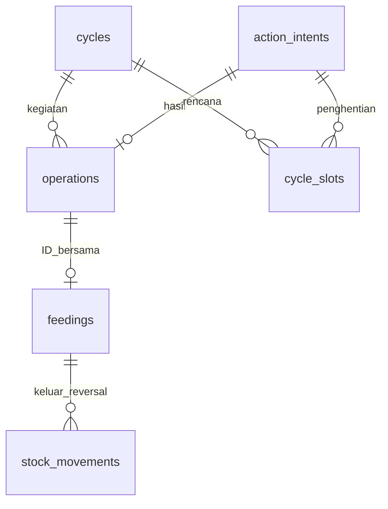
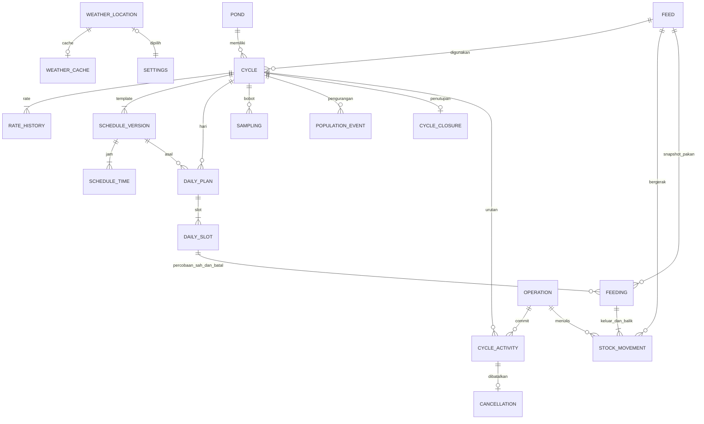

# Rancangan Database FishCare

Tanggal: 13 Oktober 2026. Skema aktual M4 versi4; desain penuh di luar milestone tetap provisional.

## Lokasi/cuaca atas tindakan pengguna — skema aktual5

14 Oktober 2026, FR-08/AT-41–45; [TAHAP_CUACA_LOKASI.md](TAHAP_CUACA_LOKASI.md). Tambah dua tabel tanpa mengubah data M1–M5. Upgrade1–3 melalui4 lalu5;4→5 menambahkan tabel saja. Callback migrasi atomik, tidak reset/uninstall. Marker M0 tetap terpisah.

`weather_location`: id INTEGER PK CHECK1 (satu lokasi global), name TEXT NOT NULL trim nonkosong; latitude/longitude REAL NOT NULL rentang−90..90/−180..180 derajat, validasi finite di domain; approximate INTEGER0/1 NOT NULL, accuracy REAL nullable meter>=0. `weather_cache`: location_key TEXT PK (koordinat kanonik), body TEXT NOT NULL respons tervalidasi, fetched_ms INTEGER NOT NULL UTC epoch ms. Parsing ulang cache wajib sebelum ditampilkan; rusak tidak mengganti respons valid. Lokasi calon/izin/loading/request generation hanya di memori, bukan transaksi atau koordinat otomatis dari startup.

Konfirmasi mengganti row id1 dalam satu transaksi; rollback mempertahankan row lama. Jika hasil respons teknis belum pasti, baca kembali row, bukan mengarang gagal/sukses. Cache lama tetap terpisah dan tidak dianggap cuaca baru. Penulisan cache memeriksa lokasi aktif di transaksi; callback lokasi lama tidak menulis untuk lokasi baru. Tidak ada pengaruh cuaca/lokasi pada siklus/feedings/stock/rate/populasi/snapshot. Backup/restore belum dibangun.

## Pembaruan M5 — query laporan tanpa perubahan skema

FR-07, AT-18/19/37–40. Skema tetap4; M5 hanya membaca data M1–M4, tanpa reset/migrasi baru. Upgrade dari versi1–3 tetap migrasi M4 yang menjaga data. [M5_IMPLEMENTASI.md](M5_IMPLEMENTASI.md). M4 belum diverifikasi HP.

`operations JOIN cycles JOIN ponds LEFT JOIN feedings` memuat kegiatan dan snapshot pemberian; WHERE business_date>=start AND <=end serta optional cycles.pond_id dipakai bersama pada semua total/pendukung periode. Tidak menyaring ponds.is_archived, sehingga arsip termasuk. Batal disimpan di hasil riwayat, tetapi fold total melewati cancel_action_id non-NULL. Quantity feeding adalah aktual gram, bukan planned_g. Mati hanya death; panen hanya partial/final, close tanpa panen tidak berkontribusi. Biaya mengambil feedings.cost_snapshot, nilai dari operations.value_rp, bukan harga/bobot/rate master.

Seluruh query periode, daftar kolam, kondisi terkini dan seluruh siklus berada dalam satu transaksi baca konsisten. Query current/whole hanya mengikuti kolam, **tidak** rentang tanggal, dan diberi label scope. Akumulasi BigInt lalu cek int64, tanpa pembulatan kedua. Snapshot hilang/overflow dianggap gagal baca, bukan nol. Tidak menambahkan total ke tabel, cache permanen, index/dependency/schema baru atau rumus FCR/keuntungan.

Sinyal in-memory sesudah commit hanya meminta UI membaca ulang; tidak mengganti ActionJournal/persistensi. Revision request pada controller menolak respons/error yang kalah baru; filter immutable dibawa ke pendukung/detail. Regresi migrasi3→4 juga memeriksa hasil laporan snapshot feeding/canceled lama, sementara regresi1/2→4 tetap suite M4.

## Pembaruan M4 — skema aktual dan atomisitas

Menggantikan batas pembatalan M3 di bawah. Uji manual M2+M3 lulus menurut pengguna; M4 native belum diverifikasi. [M4_IMPLEMENTASI.md](M4_IMPLEMENTASI.md). FR-05/06, AT-08/11–17/31–36. Database `fishcare_app.db` terpisah marker M0. Upgrade1/2/3→4 bertransaksi, tanpa reset; tambah kondisi dari data awal dan impor seluruh feedings (termasuk batal) menurut seq lama. Ledger/snapshot/ID/master/rate/template lama tetap. Kegagalan rollback; downgrade ditolak.

| Tabel/kolom | Tipe, satuan, relasi, constraint |
|---|---|
| cycles.current_count/current_weight_cg | INTEGER int64 ekor>=0 / seperseratus gram>0; initial_count/weight_cg tetap awal |
| cycles.closed_action_id | TEXT nullable FK action_intents.id |
| cycle_slots.stopped_action_id | TEXT nullable FK niat; membedakan stop penutupan dari Lewati |
| operations.seq/id | INTEGER PK AUTOINCREMENT urutan commit lintas jenis; TEXT UNIQUE NOT NULL FK niat |
| cycle_id/business_date/kind | TEXT FK cycles; TEXT YYYY-MM-DD; CHECK feeding/sampling/death/partial/final/close |
| before_count/after_count | INTEGER ekor>=0 snapshot pemulihan |
| before_weight_cg/after_weight_cg | INTEGER seperseratus gram>0 snapshot pemulihan |
| quantity | INTEGER: gram untuk feeding, ekor lainnya; close0, jenis lain>0 |
| harvest_weight_cg/price_rp_kg/value_rp | INTEGER nullable; partial/final wajib >0/>0/>=0; nonpanen NULL; nilai half-up jumlah×bobotCg×harga/100000 |
| cancel_action_id/cancel_reason/created_at_ms | TEXT UNIQUE nullable FK niat, TEXT wajib jika batal, INTEGER epoch ms; final/close tidak boleh batal |

Unique partial index satu sampling sah per cycle/date; index cycle/seq. Populasi, active, tanggal dan last sequence divalidasi ulang dalam transaksi. Angka/input maksimal2desimal bobot, BigInt dan pemeriksaan hasil int64; bukan float.



Hubungan operations/feedings memakai ID bersama (keduanya FK niat), bukan FK langsung antar tabel. Snapshot M3 tetap utuh. Commit M4: validasi→operasi/snapshot→current→pending→hasil niat. Final: panen bila ada, current0/closed/closed_action_id dan seluruh pending tersimpan→skipped/stopped_action_id, planned_g tetap. Flag stopped membedakan penghentian dari Lewati; given/skipped lama utuh. Closed tidak mematerialisasi slot baru.

Batal: baca last uncanceled seq bersama, cek active/hari/alasan, tandai batal, pulihkan kondisi before atau reversal feeding, recalc pending dan result commit bersama. Feeding menandai feedings+operations atomik. Tidak memulihkan rate/jam/skipped; retry commit ID lama tidak membalik kedua kali. Prepare niat tetap terpisah sebelum bisnis; restart inspect, retry eksplisit ID sama. Snapshot panen lama tidak mengikuti sampling baru. Backup/restore belum dibuat; pemulihan niat setelah restore tetap perlu aturan tahap terkait.

## Riwayat rancangan M0–M3

Acuan: [PRD v0.1](PRD_FishCare_Baru_v0.1.md), [alur sistem](ALUR_SISTEM.md), [wireframe](WIREFRAME.md). Baseline bagian 14 PRD masih usulan. Daftar keputusan O-01–O-09 ada di Alur Sistem bagian 11; pembulatan O-02 telah disepakati pengguna pada M2 dan diperbarui di PRD, entri lain tetap usulan. Skema di bawah merupakan rancangan penuh, bukan klaim seluruh tabel telah diimplementasikan. Skema aktual M2 dijelaskan pada bagian 14.

Keputusan RV-01–RV-03 telah ditetapkan pengguna untuk M3 dan diterapkan pada sumber M2/M3. Verifikasi runtime masih terhalang. Aturan lintas sampling/pengurangan ditetapkan pengguna pada M4. Database marker M0 terpisah dari produk. Lihat [M3_IMPLEMENTASI.md](M3_IMPLEMENTASI.md).

## Keputusan M3 yang menggantikan baseline koreksi sebelumnya

Keputusan pengguna M3 telah dicatat pada PRD bagian 4/5 dan AT-29–31. Bagian rancangan di bawah yang masih menyebut stok masuk tidak dapat dikoreksi, rate/jam/Lewati sebagai penghalang, atau operation hanya hasil commit merupakan baseline historis yang digantikan aturan ini:

- Stok bersama memakai ledger. Koreksi stok masuk menyimpan asal, jumlah efektif lama/baru, alasan dan pergerakan selisih. Baru harus >=0 dan saldo akhir >=0; pratinjau lama yang stale ditolak. Asal tidak dihapus.
- Pemberian sah terakhir hari ini dalam siklus aktif boleh dibatalkan setelah rate/jam/Lewati. Stok dipulihkan tepat lewat reversal, catatan keluar asli tetap dijumlahkan, snapshot lama tidak diubah. M4 memperluas kandidat menjadi kegiatan sah terakhir lintas jenis; lihat bagian pembaruan M4.
- ID niat/payload disimpan sebelum transaksi bisnis. Hasil commit ditulis bersama perubahan bisnis. Setelah restart, baca ID yang sama dan periksa hasil sebelum menawarkan retry eksplisit; tidak memakai ID baru otomatis.
- Lewati membagi ulang sisa hanya ke pending. Jam hari ini tetap, template jam baru tetap besok. Tidak membuat pemberian nol.

Rincian skema versi3, transaksi, UI pemulihan dan uji ada di [M3_IMPLEMENTASI.md](M3_IMPLEMENTASI.md). Uji manual gabungan M2+M3 kemudian dikonfirmasi berhasil oleh pengguna; verifikasi standar tetap sesuai bukti. Pernyataan lama adalah riwayat rancangan, bukan aturan implementasi M3.

## 1. Konvensi penyimpanan dan sumber kebenaran

FR-01–09; PRD bagian 4 dan 8; AT-03, AT-15, AT-25, AT-27.

| Bentuk | Tipe SQLite usulan | Satuan/aturan |
|---|---|---|
| ID entitas/operasi | TEXT | ID acak stabil, tidak memakai nama sebagai relasi; PK unik |
| Jumlah ikan, pakan, rupiah | INTEGER | Ikan ekor; pakan gram bulat; uang rupiah bulat atau rupiah/kg; nonnegatif sesuai field |
| Bobot rata-rata | INTEGER | `weight_cg`: seperseratus gram; 12,50 g disimpan 1250, bukan float |
| Rate | INTEGER | `rate_bp`: seperseratus persen; 3% disimpan 300; >0 sampai 10000 |
| Jam pemberian | INTEGER | `minute_of_day`: 0–1439; tampilan HH:mm |
| Tanggal usaha | TEXT | YYYY-MM-DD tervalidasi kalender dalam zona usaha; dibandingkan inklusif |
| Timestamp | INTEGER | Epoch milidetik UTC; waktu penyedia cuaca dikonversi dengan zona/offset jelas |
| Zona usaha | TEXT | ID zona waktu yang valid; default perangkat, penguncian O-06 |
| Enum/bool | TEXT / INTEGER | Enum lowercase dengan CHECK; boolean 0/1 |
| Koordinat/nilai cuaca | REAL | Finite, rentang tervalidasi; tidak dipakai aritmetika uang/stok |

Semua kolom NOT NULL kecuali ditandai `?`. PK/FK bukan null. INTEGER usulan signed 64-bit; validasi tipe integer sungguhan dan rentang dilakukan repository serta CHECK yang relevan, karena nama tipe kolom saja belum cukup. Batas produk lebih kecil tidak dikarang; UI menolak nilai/hasil di luar kapasitas. Parser tidak menerima pemisah ribuan/angka ambigu. Sebelum simpan, semua perkalian dihitung dengan metode yang tidak overflow, baru dipastikan hasil dapat disimpan. Pembulatan half-up telah diputuskan pengguna pada M2 (PRD bagian 4): tepat setengah naik.

Sumber kebenaran: stok = jumlah seluruh `delta_g` ledger; populasi = awal minus pengurangan sah; bobot = sampling sah terakhir atau awal; rate = riwayat rate terbaru. Tidak menyimpan saldo stok atau populasi cache pada versi awal. Porsi slot adalah hasil turunan yang disimpan untuk konsistensi hari; dapat direkonsiliasi. Tidak ada biaya FIFO, harga pembelian, atau tabel keuntungan.

## 2. Diagram relasi



`FEEDING`, `SAMPLING`, `POPULATION_EVENT`, perubahan rate/jam/Lewati, dan `CYCLE_CLOSURE` masing-masing mengacu ke satu `CYCLE_ACTIVITY`. `CANCELLATION` mengacu ke kegiatan asal dan satu kegiatan pembatalan. FK tambahan ini dijelaskan di kamus agar diagram tetap terbaca. Cache cuaca tidak wajib ikut backup.

## 3. Kolom bersama dan audit operasi

Kolom berikut merupakan bagian setiap tabel yang ditunjuk, bukan tabel terpisah:

- Master `pond`, `feed`, `settings`: `created_at_ms INTEGER`, `updated_at_ms INTEGER`.
- Entitas kegiatan: `activity_id TEXT UNIQUE FK cycle_activity`; tanggal/timestamp/urutan berasal dari kegiatan tersebut.
- Kegiatan dapat batal (`feeding`, `sampling`, `population_event`): `cancelled_by_id TEXT? UNIQUE FK cancellation`. Null = sah; tidak null = batal. Tidak menyimpan enum sah/batal kedua yang dapat berbeda dari FK tersebut.
- FK menggunakan RESTRICT untuk penghapusan normal; UI tidak hard-delete. Restore mengosongkan/mengisi tabel dalam urutan FK dalam transaksi khusus. FK harus aktif pada setiap koneksi dan diperiksa lagi saat restore.

| Tabel | Kolom | Constraint dan arti |
|---|---|---|
| `operation` (aktual M3: `action_intents`) | `id TEXT PK`, `kind TEXT`, `payload_canonical TEXT`, `target_key TEXT`, `state TEXT`, `created_at_ms INTEGER`, `committed_at_ms INTEGER?`, `result TEXT?`, `error TEXT?`, `acknowledged INTEGER` | Niat/payload kanonik disimpan sebelum transaksi bisnis; enum prepared/committed/rejected/abandoned. Hasil commit ditulis bersama bisnis. Target prepared unik; ID sama/payload berbeda ditolak. Setelah restart diperiksa, retry eksplisit tetap ID sama |
| `cycle_activity` | `id TEXT PK`, `cycle_id TEXT FK`, `seq INTEGER`, `kind TEXT`, `business_date TEXT`, `occurred_at_ms INTEGER`, `operation_id TEXT FK UNIQUE` | UNIQUE(cycle_id,seq), seq >0; enum `start,feeding,skip,sampling,death,partial_harvest,rate_change,schedule_change,close,cancel`. Urutan commit per siklus; bukan waktu HP yang mungkin berubah |
| `cancellation` (rancangan penuh; aktual M4 kolom operations) | `id TEXT PK`, `original_activity_id TEXT FK UNIQUE`, `cancellation_activity_id TEXT FK UNIQUE`, `reason TEXT` | Alasan trim tidak kosong; asal dan pembatalan dalam siklus sama. M4 kandidat sah terakhir lintas pemberian/sampling/kematian/parsial hari ini pada active. Hubungan balik ditulis atomik |

Tabel operation juga dipakai untuk master/stok/pengaturan yang tidak mempunyai kegiatan siklus. Kegiatan start dan close dibuat sekali; satu operasi close boleh membuat panen akhir dan closure dengan activity yang sama. Jenis/target FK polimorfik pada operation diverifikasi repository dan validator backup, bukan dianggap dijamin FK SQLite. Payload memuat data lokal saja, tanpa rahasia API. Urutan commit_seq dipakai mereplay ledger stok lintas kolam; cycle_activity.seq harus konsisten dengan urutan tersebut. Ini memungkinkan validasi sejarah meskipun waktu HP berubah. Payload mutasi master menyimpan sebelum/sesudah harga; validator dapat memeriksa harga historis tanpa membandingkannya dengan master kini.

## 4. Master dan siklus

FR-01–03; AT-01–03, AT-11–15, AT-27.

| Tabel | Kolom lengkap di luar kolom bersama | Constraint/relasi |
|---|---|---|
| `pond` | `id TEXT PK`, `name TEXT`, `name_key TEXT UNIQUE`, `notes TEXT?`, `size_description TEXT?`, `is_archived INTEGER`, `archived_at_ms INTEGER?` | Nama trim tidak kosong. name_key hasil normalisasi kapitalisasi; unik termasuk arsip. Ukuran teks O-08, tidak dipakai rumus |
| `feed` | `id TEXT PK`, `name TEXT`, `name_key TEXT UNIQUE`, `recorded_price_rp_kg INTEGER`, `is_archived INTEGER`, `archived_at_ms INTEGER?` | Nama/normalisasi O-05; harga >0; tidak mempunyai kolom stok yang dapat ditimpa |
| `cycle` | `id TEXT PK`, `pond_id TEXT FK`, `feed_id TEXT FK`, `fish_label TEXT`, `initial_count INTEGER`, `initial_weight_cg INTEGER`, `start_date TEXT`, `status TEXT`, `closed_date TEXT?`, `start_activity_id TEXT FK UNIQUE` | Awal/bobot >0, label tidak kosong; status `active,closed`; closed_date null hanya jika aktif. Indeks unik parsial pond_id WHERE status='active'. Input awal/pakan tidak dapat diubah |
| `rate_history` | `id TEXT PK`, `cycle_id TEXT FK`, `rate_bp INTEGER`, `effective_at_ms INTEGER`, `activity_id TEXT FK UNIQUE` | 1..10000; urutan activity.seq menentukan rate terbaru walaupun timestamp sama/berubah. Awal satu catatan rate; perubahan berlaku langsung |
| `cycle_closure` | `id TEXT PK`, `cycle_id TEXT FK UNIQUE`, `activity_id TEXT FK UNIQUE`, `final_event_id TEXT? FK population_event`, `remaining_count_before INTEGER` | >0 menuntut final_event akhir dengan jumlah sama; nol menuntut final_event null. Tidak dapat batal. Snapshot sisa sebelum penutupan untuk audit |

Repository/trigger yang akan dipilih saat implementasi menjaga: kolam/pakan arsip tidak bisa dipilih untuk siklus baru; arsip ditolak jika ada siklus aktif; tidak ada aktivitas setelah closed kecuali pembacaan; perubahan master tidak mengubah relasi. Aturan lintas tabel ini tidak dapat dipenuhi CHECK satu baris saja. Normalisasi nama harus konsisten di form, penyimpanan, migrasi, restore; jangan mengandalkan collation ASCII saja untuk label Unicode.

## 5. Template dan slot harian

FR-02/04; AT-02, AT-08–10, AT-26, AT-28.

| Tabel | Kolom | Constraint/aturan |
|---|---|---|
| `schedule_version` | `id TEXT PK`, `cycle_id TEXT FK`, `effective_date TEXT`, `created_activity_id TEXT FK`, `updated_activity_id TEXT FK` | UNIQUE(cycle_id,effective_date). Versi awal hari tebar; perubahan selalu besok. Versi besok yang belum efektif boleh diganti dalam transaksi; audit payload operation menyimpan sebelum/sesudah |
| `schedule_time` | `id TEXT PK`, `schedule_version_id TEXT FK`, `minute_of_day INTEGER` | 0..1439; UNIQUE(version,minute); jumlah 1–6 diperiksa repository dalam transaksi |
| `daily_plan` | `id TEXT PK`, `cycle_id TEXT FK`, `business_date TEXT`, `schedule_version_id TEXT FK`, `created_at_ms INTEGER` | UNIQUE(cycle,date); template terakhir efektif <=tanggal. Hari sebelum tebar ditolak |
| `daily_slot` | `id TEXT PK`, `daily_plan_id TEXT FK`, `minute_of_day INTEGER`, `planned_g INTEGER?`, `status TEXT`, `skip_reason TEXT?`, `status_activity_id TEXT? FK`, `updated_at_ms INTEGER` | UNIQUE(plan,minute); status `pending,given,skipped`; planned_g >=0 atau null jika belum bisa dihitung; skip_reason `user,cycle_closed` hanya untuk skipped |

Slot diberikan mempunyai tepat satu pemberian sah. Slot skipped tidak mempunyai pemberian sah. Slot pending tidak mempunyai pemberian sah, walaupun boleh mempunyai riwayat batal. Seluruh hubungan diperiksa dalam transaksi dan restore. Null planned_g berarti data tidak lengkap, berbeda dari 0 yang berarti tidak ada sisa kebutuhan.

Porsi hari ini hanya ditulis ulang untuk pending; porsi rencana slot given/skipped tetap untuk audit. Sebelum perubahan jam, materialisasikan hari ini dari versi lama sehingga AT-10 benar walau halaman belum dibuka. Pembukaan berulang menggunakan unique key, bukan INSERT bebas. Hari yang tidak dibuka tidak membutuhkan slot sintetis; tidak membuat pemberian retroaktif. Closure mengubah pending menjadi skipped dengan alasan cycle_closed sesuai O-07.

## 6. Pemberian dan pergerakan stok

FR-03–04; AT-04–07, AT-15–17, AT-25.

| Tabel | Kolom | Constraint/aturan |
|---|---|---|
| `feeding` | `id TEXT PK`, `activity_id`, `cancelled_by_id?`, `slot_id TEXT FK`, `feed_id TEXT FK`, `actual_g INTEGER`, `planned_g_snapshot INTEGER`, `price_rp_kg_snapshot INTEGER`, `cost_rp_snapshot INTEGER`, `population_snapshot INTEGER`, `weight_cg_snapshot INTEGER`, `rate_bp_snapshot INTEGER`, `daily_need_g_snapshot INTEGER`, `remaining_g_before_snapshot INTEGER` | actual/plan/price/population/weight/need/sisa >0 mengikuti O-04; cost >=0; rate 1..10000. Unik parsial slot_id WHERE cancelled_by_id IS NULL. feed_id sama dengan pakan siklus. Nilai biaya disimpan dan tidak dihitung ulang dari master |
| `stock_movement` | `id TEXT PK`, `feed_id TEXT FK`, `business_date TEXT`, `occurred_at_ms INTEGER`, `kind TEXT`, `delta_g INTEGER`, `operation_id TEXT FK`, `feeding_id TEXT? FK`, `cancellation_id TEXT? FK`, `reverses_movement_id TEXT? FK UNIQUE` | kind `in,correction,feeding_out,feeding_reversal`; correction menyimpan referensi asal dan delta baru-lama; in delta >0 tanpa referensi pemberian; out delta <0, feeding wajib; reversal delta >0 dan semua referensi wajib |

Unik (feeding_id,kind) untuk jenis out/reversal; setiap pemberian mempunyai satu out sebesar -actual_g. Setiap pembatalan pemberian mempunyai satu reversal sebesar +actual_g yang mengacu out asal; pakan keduanya sama. Ledger append-only: semua baris dijumlahkan, termasuk out milik pemberian batal dan reversal. Jangan mengecualikan out batal dari saldo, karena reversal sudah mengimbanginya. Stok masuk tidak dibatalkan/ditimpa. M3 menambah enum correction: selisih baru-lama, referensi asal, dan audit old/new/reason; jumlah efektif/saldo harus nonnegatif.

Harga master bukan snapshot stok masuk/pembelian. Nama master boleh berubah; detail historis tetap terhubung melalui ID dan dapat menampilkan nama kini dengan angka snapshot lama. Tidak mengklaim nama lama direkam bila memang tidak disimpan.

## 7. Sampling dan pengurangan populasi

FR-05–06; AT-08–09, AT-11–17.

| Tabel | Kolom | Constraint/aturan |
|---|---|---|
| `sampling` | `id TEXT PK`, `cycle_id TEXT FK`, `business_date TEXT`, `sample_count INTEGER`, `average_weight_cg INTEGER`, `population_before_snapshot INTEGER`, `activity_id`, `cancelled_by_id?` | Jumlah/bobot >0; sample_count <=populasi saat transaksi. Unik parsial (cycle,date) WHERE cancelled_by_id IS NULL; date sama dengan activity.business_date |
| `population_event` | `id TEXT PK`, `cycle_id TEXT FK`, `kind TEXT`, `count INTEGER`, `population_before_snapshot INTEGER`, `harvest_weight_cg_snapshot INTEGER?`, `sale_price_rp_kg_snapshot INTEGER?`, `harvest_value_rp_snapshot INTEGER?`, `activity_id`, `cancelled_by_id?` | kind `death,partial_harvest,final_harvest`; count >0 <=populasi. death ketiga snapshot panen null; panen bobot/harga >0, nilai >=0. Partial count <populasi; final count =populasi dan tidak batal |

Unik parsial cycle_id untuk final_harvest. Populasi sebelum kegiatan adalah snapshot, bukan saldo yang dapat diedit. Sampling tidak mengurangi ikan. Bobot panen bukan pengganti sampling. Pembatalan mengubah status melalui FK tetapi tidak mengubah jumlah/bobot/harga/nilai historis.

## 8. Pengaturan dan cuaca

FR-08–09; AT-20–24, AT-26.

| Tabel | Kolom | Constraint/aturan |
|---|---|---|
| `settings` | `id INTEGER PK`, `business_timezone TEXT`, `timezone_locked INTEGER`, `weather_location_id TEXT? FK`, `last_backup_success_at_ms INTEGER?`, `last_backup_exported_at_ms INTEGER?`, ditambah created/updated | Singleton id=1. Zona valid; O-06 menentukan saat terkunci. Null backup = Belum pernah backup |
| `weather_location` | `id TEXT PK`, `provider TEXT`, `provider_place_id TEXT?`, `display_name TEXT`, `admin_region TEXT?`, `country TEXT?`, `latitude REAL`, `longitude REAL` | Koordinat finite -90..90/-180..180; identitas cache memasukkan provider+koordinat, bukan hanya nama kota |
| `weather_cache` | `location_id TEXT PK FK`, `condition_code INTEGER?`, `air_temperature REAL?`, `temperature_unit TEXT?`, `rain_probability REAL?`, `probability_unit TEXT?`, `forecast_business_date TEXT?`, `provider_data_at_ms INTEGER?`, `fetched_at_ms INTEGER`, `provider_timezone TEXT?`, `provider TEXT` | Probabilitas 0..100 jika tersedia; null disertai status tidak tersedia di UI. Timestamp penyedia null hanya jika field tidak tersedia, tidak direka dari fetched_at |

Cache menyimpan data terstruktur tervalidasi, bukan respons JSON yang dipercaya tanpa pemeriksaan. Lokasi/koordinat berada pada FK yang stabil. Request token/query generation, status loading/error, dan throttle percobaan terakhir per lokasi dikelola klien; token dibatalkan saat restore/ganti lokasi. Provider, satuan, waktu data/pengambilan tersedia untuk kartu; link atribusi dibundel. Tidak ada tabel sensor air, rekomendasi cuaca, atau polling background.

## 9. Aritmetika dan snapshot

Dengan W=weight_cg, R=rate_bp, N=populasi, A=actual_g, H=harga rupiah/kg:

```text
biomassa gram = N × W / 100 (tanpa dibulatkan lebih dulu)
kebutuhan gram = round(N × W × R / 1_000_000)
biaya rupiah = round(A × H / 1000)
nilai panen rupiah = round(count × harvest_weight_cg × sale_price / 100_000)
```

Semua input asli dan hasil bulat disimpan untuk pemberian/panen. O-02 pembulatan telah disepakati pengguna: half-up pada pecahan nonnegatif. Kalkulator dan jadwal memakai fungsi aturan bisnis sama; UI tidak mempunyai versi rumus sendiri. Ringkasan biaya/nilai menjumlahkan hasil per transaksi, tanpa pembulatan gabungan. Total agregasi juga diperiksa overflow.

## 10. Batas transaksi atomik dan idempotensi

PRD bagian 4/9; AT-05–07, AT-13, AT-16–17, AT-25.

Untuk mutasi: ambil kunci penulisan melalui transaksi SQLite yang sesuai (usulan BEGIN IMMEDIATE), cek operation.id, baca tanggal/kondisi dari sumber kebenaran, validasi ulang, tulis semuanya, lalu commit. Dua kolam menggunakan stok bersama diserialisasi oleh transaksi, bukan saldo yang dibaca sebelumnya di form. Jika ID sudah commit dan payload sama, kembalikan hasil lama; payload berbeda ditolak. Jika tidak ditemukan, ulangi dengan ID sama. Crash sebelum commit meninggalkan semua perubahan batal; sesudah commit retry menemukan hasil. ID operasi ikut backup.

| Operasi | Yang harus commit bersama |
|---|---|
| Mulai siklus | operation, activity start, cycle, rate awal, versi jam+jam, daily plan+slot, kunci zona |
| Stok masuk | operation, ledger in, kunci zona |
| Berikan | operation, activity, feeding snapshot, ledger out, status slot, porsi semua pending |
| Lewati | operation, activity skip, status/alasan, redistribusi pending usulan O-03 |
| Sampling/rate/pengurangan | operation, activity, entitas/snapshot, hasil porsi pending |
| Ubah jam | materialisasi hari ini versi lama, operation/activity, versi besok dan daftar jam; jam hari ini utuh |
| Batalkan | operation/activity cancel, cancellation, FK batal asal, ledger reversal jika pemberian, pemulihan status slot/kondisi efektif, porsi pending |
| Tutup | operation/activity close, final panen bila populasi >0, closure, status/tanggal cycle, pending dihentikan |
| Arsip master | operation, cek tidak dipakai siklus aktif, status arsip |
| Restore | penggantian semua data wajib, validasi akhir, versi/pengaturan; gagal rollback |

Keunikan siklus aktif/slot/sampling/pemberian menjadi pertahanan tambahan. Constraint lintas baris (saldo >=0, populasi >=0, 1–6 jam, kegiatan terakhir) diperiksa repository dalam transaksi dan validator restore. Pilihan trigger tambahan serta dukungan indeks parsial diperiksa pada M0; jangan mengklaim constraint tersedia sebelum versi SQLite diuji.

Pembatalan O-01 M4 mencari seq operations sah terakhir lintas pemberian/sampling/kematian/parsial dalam siklus aktif hari ini. Rate/jam/Lewati bukan penghalang. Pembatalan kedua asal sama tidak menambah pemulihan. Permintaan close baru ketika sudah closed ditolak; retry ID close sama mengembalikan hasil commit. Akhir/closed tidak dapat dibatalkan.

## 11. Indeks, laporan, dan rekonsiliasi

FR-07; AT-18–19.

- Indeks FK: cycle(pond_id), cycle(feed_id), stock_movement(feed_id,business_date), cycle_activity(cycle_id,business_date,seq), daily_plan(cycle_id,business_date), sampling(cycle_id,business_date), population_event(cycle_id), feeding(slot_id), cancellation(original_activity_id). Tambahkan yang terbukti dibutuhkan, jangan mengarang hasil performa.
- Query periode memakai satu objek filter tanggal inklusif + pond_id opsional. Join transaksi ke cycle_activity/cycle/pond; hanya cancelled_by_id null untuk total kegiatan. Panen mencakup partial dan final. Riwayat dapat menampilkan batal.
- Ringkasan lima metrik dibaca dalam satu read snapshot agar konsisten saat mutasi terjadi. Kondisi sekarang dan total seluruh siklus query terpisah berlabel jelas.
- Rekonsiliasi: saldo ledger tidak negatif, setiap feeding ada out tepat, setiap feeding batal ada reversal tepat, populasi cocok pengurangan sah, slot given cocok feeding sah, satu sampling sah per tanggal, closure cocok final/nol, semua porsi pending cocok rumus kondisi terkini pada hari aktif. Ketidakcocokan menghasilkan error/investigasi, bukan perbaikan dengan menghapus riwayat.

## 12. Versi skema, backup, dan pemulihan

FR-09; AT-23–25. Usulan versi awal skema `1`; nomor ini rancangan, belum database berjalan. SQLite user_version dan metadata format backup dicocokkan. Migrasi berikutnya harus bertahap, transaksional, menjaga ID/snapshot/ledger, dan diuji dengan data versi lama. Versi lebih baru ditolak, tanpa downgrade/reset otomatis.

Usulan format backup: satu file JSON UTF-8 dengan `format=fishcare`, `format_version=1`, `schema_version`, `exported_at_ms`, `business_timezone`, dan array setiap tabel wajib. Integer 64-bit dikodekan sebagai string desimal kanonik untuk mencegah kehilangan presisi lintas parser; validator memeriksa bentuk dan rentang, bukan menerima angka pecahan. Aturan ini teknis usulan, tidak menetapkan dependency. Nullable harus eksplisit null. Tabel wajib harus ada walaupun array kosong.

Tabel wajib: operation, cycle_activity, cancellation, pond, feed, cycle, rate_history, cycle_closure, schedule_version, schedule_time, daily_plan, daily_slot, feeding, stock_movement, sampling, population_event, settings, weather_location (bila lokasi tersimpan, tetap array wajib). weather_cache opsional dan tidak diperlukan untuk pemulihan budidaya. Metadata waktu ekspor menggambarkan snapshot; backup terakhir berhasil di settings tidak direka sebelum file benar-benar tersimpan. File baru tidak perlu merekam klaim keberhasilan penulisan dirinya sendiri.

Urutan backup: read transaction mengambil satu snapshot seluruh tabel → serialisasi tanpa mutasi sumber → pemilih sistem/tulis → konfirmasi selesai → update last_backup_success_at_ms dan waktu snapshot. Batal/gagal tidak mengubah status. Jika file tersimpan tetapi update metadata lokal gagal, jelaskan dua hasil tersebut dan jangan membuat klaim status lokal berhasil.

Urutan restore:

1. Batasi ukuran/input sesuai kapasitas aman yang ditetapkan implementasi; parse dan validasi format/versi sebelum menyentuh database aktif.
2. Validasi daftar tabel/kolom, tipe/rentang, tanggal kalender/zona, PK/unik, FK, enum, snapshot rumus, ledger dan pembatalan, urutan kegiatan, saldo/populasi, template/slot/closure. Replay menurut operation.commit_seq, dengan pembatalan baru berlaku saat operasi pembatalan, bukan sejak transaksi asal. Validasi sejarah agar tidak ada pengurangan/pemberian yang melampaui saldo/populasi saat terjadi, bukan hanya saldo akhir. Snapshot feeding dicocokkan kondisi efektif pada seq tersebut; snapshot harga/nilai historis tidak dibandingkan dengan harga master sekarang. Tidak mengganti snapshot invalid dengan hasil hitung ulang.
3. Tampilkan ringkasan isi; konfirmasi bahwa seluruh data diganti, bukan digabung. Batal tetap data lama.
4. Blokir mutasi baru sementara, buat salinan pemulihan lokal dari snapshot konsisten, verifikasi salinan dapat dibaca dan valid. Jika gagal, hentikan restore.
5. Dalam satu transaksi, kosongkan anak lalu induk, isi induk lalu anak. FK siklus/aktivitas/closure/pembatalan yang melingkar memerlukan deferred FK selama transaksi; FK diperiksa sebelum commit. Terapkan versi yang didukung; periksa ulang seluruh invariants. Gagal => rollback; data aktif lama utuh.
6. Sesudah commit, invalidasi state UI dan request API, muat ulang pengaturan termasuk zona/lock, lalu halaman. Cache lama dibuang atau dimuat hanya jika lokasi sama dan valid. Restore sukses tidak berarti baru melakukan backup eksternal.

Saat aplikasi berhenti di tengah restore, transaksi menjamin dataset lama atau dataset baru utuh. Salinan lokal pemulihan adalah perlindungan tambahan, bukan pengganti rollback atau backup eksternal. Kebijakan retensi salinan lokal ditetapkan pada implementasi tanpa menimpa file backup pengguna.

## 13. Peta verifikasi rancangan

| FR | Elemen utama | AT |
|---|---|---|
| FR-01–02 | pond, cycle, rate, template; unik aktif | AT-01–03, AT-10, AT-27 |
| FR-03–04 | feeding, slot, ledger, operation, cancellation | AT-02–10, AT-15–17, AT-25–28 |
| FR-05–06 | sampling, population_event, closure | AT-08–09, AT-11–17, AT-25 |
| FR-07 | filter bersama, snapshot aggregate, invalidasi | AT-18–19 |
| FR-08 | settings/location/cache, token request | AT-01, AT-20–22 |
| FR-09 | versi/format, snapshot ekspor, restore atomik | AT-23–25 |

O-01 memengaruhi activity/urutan koreksi; O-02 memengaruhi parser dan snapshot; O-03/O-04 memengaruhi slot; O-05 master; O-06 settings; O-07 closure; O-08 pond; O-09 status rancangan. Pembulatan O-02 telah diputuskan pengguna pada M2; entri lain tetap belum merupakan keputusan produk final. M0 masih diperlukan untuk membuktikan SQLite, migrasi dasar/FK/indeks, persistensi, serta kompatibilitas plugin/build; dokumen ini tidak membuktikan tes aplikasi lulus.

## 14. Implementasi bertahap M2: skema 1 ke 2

File produk `fishcare_app.db` dinaikkan dari versi1 (master M1) menjadi versi2. `onUpgrade` menambah tabel dalam transaksi migrasi SQLite; tidak DROP/reset atau mengubah baris `ponds`/`feeds`. Fresh install membuat master lalu tabel M2. Versi tak didukung ditolak. Foreign key aktif pada koneksi aplikasi. Tes migrasi menggunakan file terisolasi dan memeriksa nama/catatan/arsip/harga/revisi tetap, belum hasil runtime HP.

Tabel aktual: `cycles` (FK pond/feed, jumlah awal ekor, weight_cg, tanggal usaha, status, payload awal); `cycle_rates` (rate_bp, seq commit, operation_id unik, timestamp); `cycle_schedules` (unik siklus/tanggal efektif); `cycle_times` (unik versi/menit); `cycle_slots` (PK siklus/tanggal/menit, planned_g, pending); `schedule_changes` (ID operasi unik, versi/tanggal besok, jam sebelum/sesudah); `business_settings` (singleton zona terpilih terkunci setelah siklus pertama). Struktur ini irisan sederhana dari model konseptual, belum tabel pemberian/panen/stok/pembatalan.

Indeks parsial `one_active_cycle` membatasi satu siklus aktif per kolam. Start menyimpan cycle/rate/template/jam/slot awal/zona sekaligus. Perubahan rate menyimpan riwayat dan menghitung ulang pending hari ini atomik. Perubahan jam memastikan slot hari ini dari versi lama, lalu mengganti template efektif besok; update berulang tidak menambah versi efektif ganda. PK slot menjaga pembukaan ulang idempoten. Arsip kolam/pakan ditolak dalam transaksi jika digunakan siklus aktif. Rincian sumber, satuan, transaksi dan uji: [M2_IMPLEMENTASI.md](M2_IMPLEMENTASI.md).

## 15. Implementasi aktual M3: skema 1/2 ke 3

Skema aktual menambah `action_intents`, `feedings`, `stock_movements`, `stock_corrections`; enum slot diperluas pending/given/skipped. Seluruh tabel master/siklus/rate/template/jam dipertahankan. Slot disalin ke tabel dengan CHECK baru, jumlah baris diverifikasi, lalu tabel diganti dalam transaksi migrasi; gagal berarti rollback, bukan reset data. FK slot komposit dan indeks feeding sah/out/reversal unik ditambahkan. Skema aktual M3 adalah irisan dari rancangan konseptual penuh, belum tabel sampling/pengurangan/panen/restore.

Niat M3 menyimpan ID/kind/payload kanonik/target/state/result/error/acknowledged sebelum bisnis. Domain/result commit bersama; prepared yang belum mempunyai hasil final dipulihkan setelah restart melalui ID sama. Urutan audit M3 memakai seq feeding dan seq ledger yang disimpan saat commit, tidak mengandalkan jam HP. `commit_seq` global untuk replay penuh yang disebut pada rancangan konseptual perlu dibekukan sebelum restore lintas entitas masa depan; tidak diklaim telah ada pada action_intents M3.

Ledger memiliki empat kind in/correction/out/reversal. Koreksi menyimpan old/new/reason dan referensi asal, tanpa mengubah asal; saldo/jumlah efektif dibaca dengan penjumlahan BigInt dalam transaksi. Feedings menyimpan gram/harga/rate/populasi/bobot/biomassa/biaya snapshot dan metadata batal; out tetap dihitung bersama reversal. Pending memakai kebutuhan terbaru minus total actual sah; given/skipped tidak didistribusikan ulang. Rincian kolom, constraint, urutan migrasi, skenario crash/rollback dan batas pemeriksaan ada di [M3_IMPLEMENTASI.md](M3_IMPLEMENTASI.md).


