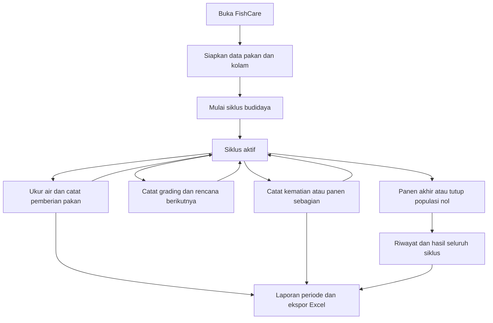
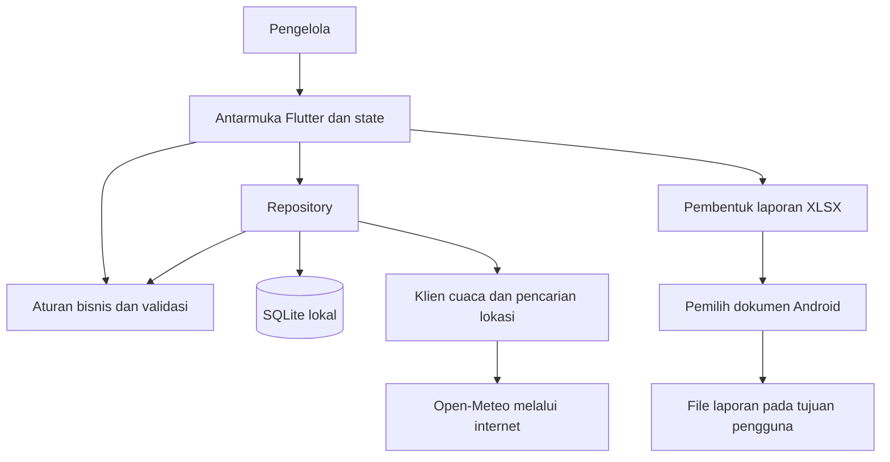
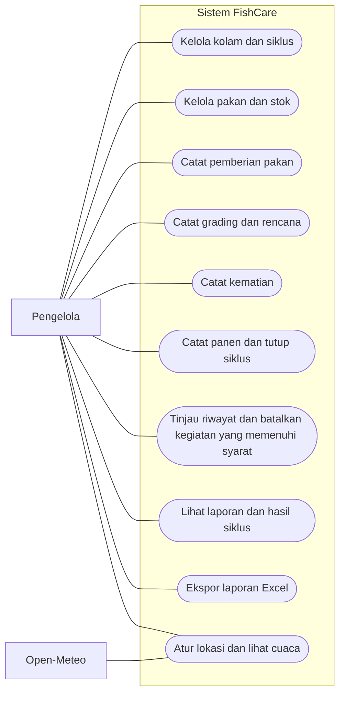
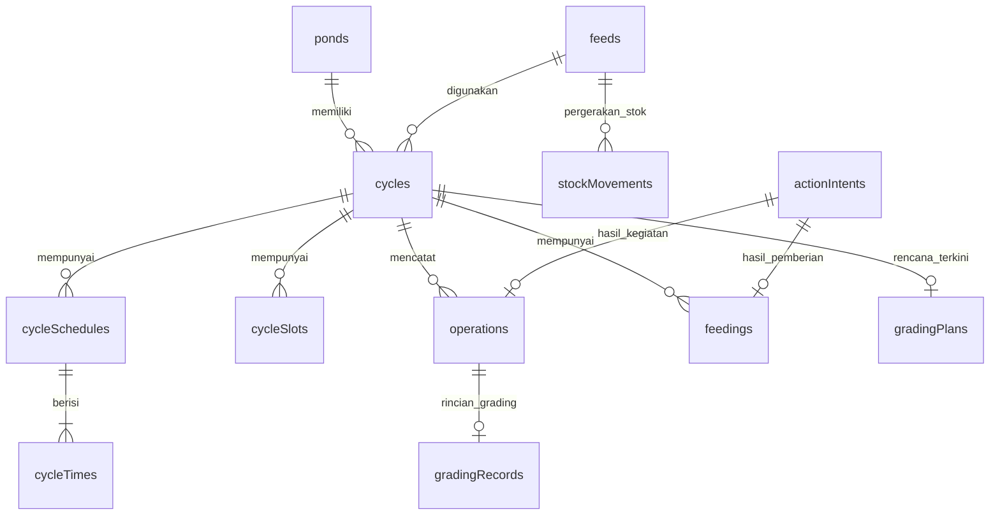

# BAB III
# PERANCANGAN SISTEM

## 3.1 Gambaran Umum Sistem

FishCare merupakan aplikasi Android untuk membantu satu pengelola mencatat kegiatan budidaya lele pada beberapa kolam. Sistem menghubungkan identitas kolam, siklus pemeliharaan, persediaan pakan, pemberian pakan, grading, kematian, dan panen dalam basis data lokal. Informasi tersebut menjadi dasar perhitungan kebutuhan pakan dan penyusunan laporan kegiatan.

Perancangan pada bab ini mengikuti batasan proyek pada Bab I dan konsep teknologi pada Bab II. Acuan yang digunakan adalah kebutuhan proyek beserta revisi terbaru, termasuk rate berdasarkan bobot lele, pengukuran air pada setiap pemberian, grading berurutan, ekspor Excel, dan ringkasan hasil setelah biaya pakan. Rancangan lama yang telah digantikan tidak digunakan sebagai perilaku aplikasi terbaru.

### 3.1.1 Pengguna dan Lingkungan Sistem

Pengguna utama adalah pengelola budidaya yang mencatat kegiatannya sendiri. Sistem tidak membedakan peran administrator dan pengguna biasa serta tidak menyediakan login. Setiap kolam dapat mempunyai beberapa siklus secara historis, tetapi hanya satu siklus yang aktif pada satu waktu. Satu siklus menggunakan satu jenis ikan dan satu jenis pakan.

Data kegiatan disimpan pada perangkat Android menggunakan SQLite. Pencatatan inti dan pembacaan laporan dirancang tetap tersedia tanpa koneksi internet. Layanan Open-Meteo digunakan untuk informasi cuaca pada satu lokasi usaha yang dipilih pengguna. Cuaca merupakan informasi tambahan dan tidak menggantikan pengukuran suhu air maupun pH pada pemberian pakan.

### 3.1.2 Alur Utama Penggunaan

Pengguna menyiapkan data pakan dan stok, membuat identitas kolam, lalu memulai siklus. Pada siklus aktif, pengguna mencatat pemberian pakan, memperbarui bobot melalui grading, serta mencatat kematian dan panen sebagian apabila terjadi. Siklus diselesaikan melalui panen akhir atau penutupan tanpa panen ketika populasi telah habis. Kegiatan yang tersimpan dapat ditinjau melalui riwayat dan laporan.

Urutan tersebut merupakan alur penggunaan yang disarankan. Stok nol tidak menghalangi pembuatan siklus, tetapi pencatatan pemberian tetap mensyaratkan stok yang mencukupi. Pengaturan cuaca dapat dilakukan secara terpisah tanpa menghalangi persiapan data budidaya.

*Gambar 3.1 Alur utama penggunaan FishCare. Laporan dapat dibuka selama siklus aktif maupun setelah selesai.*

### 3.1.3 Dasar Perhitungan Pakan

Sistem menggunakan populasi terkini dan bobot rata-rata terakhir untuk menghitung biomassa. Sebelum terdapat grading, bobot awal tebar menjadi dasar perhitungan. Rate dasar mengikuti kelompok bobot yang dipilih dalam aturan proyek.

| Bobot rata-rata ikan | Rate dasar per hari |
|---|---:|
| 2–5 gram, kedua batas termasuk | 5% |
| Lebih dari 5 sampai 10 gram | 4% |
| Lebih dari 10 sampai 35 gram | 3% |
| Lebih dari 35 sampai 50 gram | 2,5% |
| Lebih dari 50 sampai 70 gram | 2,2% |
| Lebih dari 70 gram | 2% |

*Tabel 3.1 Interval rate pada aturan FishCare, mengacu pada keputusan proyek dalam PRD bagian 15.8.*

Interval tersebut merupakan penyesuaian proyek untuk menangani bobot desimal secara kontinu. Tabel ini bukan pernyataan sertifikasi atau pembuktian kesesuaian untuk seluruh kondisi kolam biasa. Bobot di bawah 2 gram belum memiliki rate yang ditetapkan dan ditampilkan sebagai belum dapat dihitung.

Kebutuhan normal dihitung melalui rumus berikut.

**Kebutuhan normal harian (gram) = populasi × bobot rata-rata (gram) × rate / 100**

Hasil dibulatkan ke gram menggunakan pembulatan *half-up*, yaitu nilai tepat setengah dibulatkan naik. Biomassa tidak dibulatkan terlebih dahulu. Kebutuhan normal dibagi ke seluruh jam pemberian yang berlaku pada hari tersebut; sisa pembagian gram dibagikan berurutan mulai dari jam paling awal.

Rekomendasi kemudian ditentukan untuk slot yang dipilih berdasarkan pengukuran air saat itu.

| Kondisi pengukuran | Hasil rekomendasi |
|---|---|
| Suhu 25–30 °C dan pH 6,5–8, batas termasuk | Porsi normal slot |
| Suhu di bawah 24 °C dan pH 6,5–8 | 80% porsi normal slot, dibulatkan half-up |
| Suhu 24 sampai kurang dari 25 °C atau di atas 30 °C | Peringatan tanpa angka rekomendasi otomatis |
| pH di luar 6,5–8 | Peringatan tanpa angka rekomendasi otomatis |
| Pengukuran belum diisi atau tidak valid | Pengguna diminta melengkapi atau memperbaiki input |

*Tabel 3.2 Aturan rekomendasi berdasarkan pengukuran air dalam FishCare.*

Tidak tersedianya rekomendasi akibat kondisi air tidak otomatis melarang pencatatan aktual. Pengguna tetap dapat meninjau pemberian jika pengukuran dan data dasar valid, jumlah aktual positif, siklus aktif, serta stok mencukupi. Jumlah aktual selalu menjadi dasar pengurangan stok dan perhitungan biaya.

Sebagai contoh, 1.000 ikan dengan bobot rata-rata 50 gram dan rate 2,5% menghasilkan kebutuhan normal 1.250 gram per hari. Dengan dua jadwal, porsi normal masing-masing adalah 625 gram. Suhu pagi 23 °C dan pH 7 menghasilkan rekomendasi 500 gram. Apabila aktual pagi 450 gram, porsi normal sore tetap 625 gram. Jika sebelum sore terdapat grading menjadi 60 gram, rate berubah menjadi 2,2% dan kebutuhan normal menjadi 1.320 gram; porsi normal sore menjadi 660 gram. Snapshot pemberian pagi tetap dipertahankan.

Selisih aktual, pengurangan karena suhu, dan porsi yang dilewati tidak otomatis dibagikan ke jadwal lain. Perubahan bobot atau populasi memperbarui dasar porsi yang masih menunggu. Perubahan jam pemberian berlaku mulai hari berikutnya sehingga tidak menggeser jadwal hari berjalan.

## 3.2 Arsitektur Sistem

### 3.2.1 Pembagian Lapisan

Arsitektur FishCare dibagi menjadi antarmuka dan state, aturan bisnis, repository, serta sumber data. Pembagian ini memisahkan interaksi pengguna dari perhitungan dan penyimpanan. Fungsi yang membutuhkan hasil perhitungan sama menggunakan aturan bersama agar angka pada detail siklus, jadwal, dan form pemberian tetap konsisten.

*Gambar 3.2 Arsitektur FishCare. Jalur cuaca terpisah dari penyimpanan kegiatan budidaya.*

| Lapisan | Tanggung jawab | Contoh penerapan |
|---|---|---|
| Antarmuka dan state | Menerima input, menampilkan data, serta mengelola keadaan memuat dan hasil tindakan | Form pemberian, daftar kolam, filter laporan |
| Aturan bisnis | Memvalidasi nilai dan menghitung hasil sesuai ketentuan proyek | Rate bobot, rekomendasi slot, biaya pakan, hasil siklus |
| Repository | Mengatur pembacaan dan penulisan data secara konsisten | Penyimpanan pemberian, pembatalan, pembacaan laporan |
| Sumber data lokal | Menyimpan master, siklus, kegiatan, dan riwayat | SQLite melalui sqflite |
| Layanan eksternal | Memperoleh informasi cuaca dan lokasi | Open-Meteo |
| Ekspor dan layanan perangkat | Membentuk file laporan dan menyerahkan pemilihan tujuan kepada pengguna | XLSX dan pemilih dokumen Android |

*Tabel 3.3 Pembagian tanggung jawab sistem.*

### 3.2.2 Alur Penyimpanan Transaksi

Penyimpanan kegiatan mengikuti tahapan input, validasi awal, pratinjau, konfirmasi, pemeriksaan ulang dalam transaksi, dan pembaruan tampilan. Pada pemberian pakan, sistem membaca ulang kondisi siklus, harga, dan stok sebelum melakukan perubahan. Apabila kondisi yang memengaruhi pratinjau berubah, pengguna perlu meninjau kembali data tersebut.

Pencatatan pemberian, snapshot, pergerakan stok keluar, dan status slot disimpan dalam satu transaksi. Jika proses gagal, tidak boleh ada pengurangan stok sebagian atau status jadwal yang menyatakan berhasil tanpa catatan pemberian. Setelah transaksi tersimpan, halaman terkait membaca ulang data terbaru.

Setiap tindakan simpan menggunakan ID tindakan yang dipertahankan ketika permintaan yang sama diulang. Hasil tindakan dicatat bersama perubahan bisnis agar percobaan ulang tidak menghasilkan transaksi ganda. Jika aplikasi berhenti ketika hasil belum diketahui, sistem memeriksa ID tersebut sebelum menawarkan pengulangan. Tombol yang dinonaktifkan selama proses merupakan bantuan antarmuka, sedangkan perlindungan utama tetap berada pada penyimpanan.

### 3.2.3 Pemisahan Informasi Lokal dan Cuaca

Pengambilan cuaca menggunakan lokasi usaha yang telah dikonfirmasi. Respons untuk lokasi lama tidak boleh menimpa tampilan lokasi baru. Data tersimpan sementara atau cache dikaitkan dengan koordinat dan waktu pengambilan sehingga tidak ditampilkan seolah-olah merupakan pembaruan baru.

Kegagalan jaringan hanya memengaruhi informasi layanan tersebut. Data kolam, stok, kegiatan, dan laporan tetap dibaca dari SQLite. Pengambilan lokasi perangkat dilakukan atas tindakan pengguna tanpa pelacakan di latar belakang.

## 3.3 Use Case Diagram

### 3.3.1 Aktor dan Batas Sistem

Aktor utama adalah Pengelola yang menjalankan pencatatan dan membaca laporan. Open-Meteo berperan sebagai layanan eksternal untuk pencarian lokasi dan informasi cuaca. Tidak terdapat aktor administrator, layanan autentikasi, atau server pengelola data budidaya.

Diagram berikut menggambarkan hubungan aktor dengan fungsi utama. Bentuknya menggunakan flowchart Mermaid sebagai representasi use case dalam Markdown, bukan notasi UML lengkap.

*Gambar 3.3 Hubungan aktor dan use case utama FishCare.*

### 3.3.2 Rincian Use Case

| ID | Use case | Hasil yang diharapkan | Kebutuhan terkait |
|---|---|---|---|
| UC-01 | Mengelola kolam | Identitas tersimpan; kolam tanpa siklus aktif dapat diarsipkan tanpa menghapus riwayat | FR-01 |
| UC-02 | Memulai dan mengelola siklus | Populasi awal, bobot, pakan, serta jadwal terhubung dengan kolam; tidak ada dua siklus aktif | FR-02 |
| UC-03 | Mengelola pakan dan stok | Master, harga, stok masuk, dan koreksi beralasan dapat ditelusuri | FR-03 |
| UC-04 | Mencatat pemberian | Pengukuran baru, rekomendasi, aktual, biaya, dan pengurangan stok tersimpan konsisten | FR-03/04 |
| UC-05 | Mencatat grading dan rencana | Bobot terbaru, nomor grading, dan rencana berikutnya tersimpan tanpa mengurangi populasi | FR-05 |
| UC-06 | Mencatat kematian | Populasi berkurang sesuai jumlah sah tanpa menjadi negatif | FR-05 |
| UC-07 | Mencatat panen sebagian atau akhir | Jumlah dan nilai panen tersimpan; panen akhir menutup siklus | FR-05/06 |
| UC-08 | Membatalkan kegiatan yang memenuhi syarat | Catatan batal tetap ada dan dampaknya dipulihkan sesuai jenis kegiatan | FR-03–06 |
| UC-09 | Melihat laporan dan hasil siklus | Total periode serta hasil seluruh siklus disajikan dengan konteks terpisah | FR-07 |
| UC-10 | Mengekspor Excel | File Ringkasan dan Transaksi mengikuti filter laporan yang ditampilkan | FR-07 |
| UC-11 | Mengatur lokasi dan melihat cuaca | Lokasi terkonfirmasi dan informasi cuaca ditampilkan bersama waktu serta status data | FR-08 |

*Tabel 3.4 Rincian use case. ID UC digunakan untuk penjelasan bab ini, sedangkan ID FR mengikuti PRD.*

### 3.3.3 Skenario Pemberian Pakan

1. Pengguna memilih slot yang masih menunggu pada siklus aktif hari berjalan.
2. Sistem menampilkan pakan, harga per kilogram, stok, dan porsi normal berdasarkan kondisi ikan terbaru.
3. Pengguna memasukkan suhu air dan pH hasil pengukuran saat itu. Input tidak diambil otomatis dari pemberian sebelumnya atau API cuaca.
4. Sistem menampilkan status kondisi air serta rekomendasi jika aturan tersedia.
5. Pengguna mengisi aktual atau memilih menggunakan jumlah rekomendasi. Biaya diperbarui dari jumlah aktual.
6. Pengguna meninjau rincian. Pemberian berlebih terhadap batas pembanding yang berlaku memerlukan konfirmasi tambahan.
7. Sistem memeriksa ulang data dan menyimpan seluruh perubahan dalam transaksi.
8. Stok, status slot, riwayat, dan laporan diperbarui dari data tersimpan.

Jika stok tidak cukup, input tidak valid, hari telah berganti, atau siklus telah selesai, penyimpanan ditolak tanpa perubahan sebagian. Tindakan Lewati mengubah status slot tanpa pengurangan stok maupun transaksi pemberian nol, serta tidak menambahkan porsinya ke slot lain.

### 3.3.4 Skenario Grading, Panen, dan Pembatalan

Pada grading, pengguna memasukkan jumlah sampel yang ditimbang dan bobot rata-ratanya. Sistem menyimpan nomor grading berdasarkan urutan pencatatan dalam siklus, memperbarui bobot, dan menawarkan rencana tujuh hari berikutnya yang dapat diubah. Rencana terlewat hanya menghasilkan keterangan; sistem tidak membuat grading otomatis atau memblokir pemberian. Nomor catatan yang dibatalkan tidak digunakan kembali.

Panen sebagian mengurangi populasi sesuai jumlah yang dipanen dan menyimpan nilai panennya. Panen akhir menggunakan sisa populasi yang divalidasi kembali saat transaksi, lalu menutup siklus. Jika populasi telah nol, penutupan dilakukan tanpa membuat panen akhir fiktif. Siklus selesai mempertahankan riwayat dan tidak menerima kegiatan operasional baru.

Pembatalan hanya berlaku pada kegiatan sah terakhir yang memenuhi ketentuan dalam siklus aktif pada hari yang sama. Alasan pembatalan wajib dicatat. Pembatalan pemberian memulihkan stok melalui catatan pembalik, sedangkan grading atau kegiatan populasi memulihkan kondisi sesuai snapshot sebelumnya. Catatan asli tetap ada. Panen akhir dan penutupan siklus tidak dapat dibatalkan melalui aplikasi.

## 3.4 Desain Database

### 3.4.1 Struktur dan Relasi Utama

Basis data produk bernama `fishcare_app.db`. Skema sumber terbaru yang diperiksa adalah versi 7, yang telah mencakup grading serta snapshot pengukuran air. Diagram berikut menyajikan relasi inti untuk menjelaskan hubungan data, bukan daftar lengkap seluruh tabel dan kolom fisik.

*Gambar 3.4 Relasi inti database FishCare. Nama camelCase pada diagram mewakili nama tabel snake_case, misalnya `gradingRecords` berarti `grading_records`.*

Satu kolam dapat mempunyai banyak siklus sepanjang waktu. Pakan dapat dipakai oleh beberapa siklus, sehingga stoknya merupakan persediaan bersama. Satu siklus mempunyai banyak kegiatan, slot harian, serta versi jadwal. Satu operasi grading mempunyai satu rincian nomor grading, sedangkan rencana terkini disimpan terpisah per siklus.

Catatan `operations` dan `feedings` untuk pemberian menggunakan ID tindakan yang sama dan sama-sama mengacu pada `action_intents`. Hubungan ini tidak digambarkan sebagai foreign key langsung dari `operations` ke `feedings`. Pengaturan cuaca tidak dihubungkan dengan perhitungan populasi atau rekomendasi pakan.

### 3.4.2 Kelompok Tabel

| Tabel atau kelompok | Data dan fungsi utama |
|---|---|
| `ponds` | Identitas kolam dan status arsip |
| `feeds` | Identitas pakan, harga per kilogram, dan status arsip |
| `business_settings` | Zona waktu untuk penentuan tanggal usaha |
| `cycles` | Kolam, pakan, jenis ikan, kondisi awal dan terkini, status siklus, serta versi kebijakan pakan |
| `cycle_rates` | Riwayat rate untuk kompatibilitas pencatatan sebelumnya; bukan field edit rate otomatis lele |
| `cycle_schedules`, `cycle_times`, `schedule_changes` | Versi jadwal, jam, tanggal efektif, dan pencatatan perubahan jadwal |
| `cycle_slots` | Slot per siklus, tanggal, dan jam; status pemberian serta porsi normal otomatis |
| `feedings` | Aktual pemberian dan snapshot bobot, populasi, rate, harga, biaya, pengukuran air, serta rekomendasi |
| `operations` | Urutan kegiatan, jenis kegiatan, kondisi sebelum dan sesudah, snapshot panen, serta penanda pembatalan |
| `grading_records` | Hubungan ke operasi grading, nomor urut per siklus, dan kondisi rencana sebelum grading |
| `grading_plans` | Tanggal rencana terkini, asal rencana, dan revisi per siklus |
| `stock_movements`, `stock_corrections` | Pergerakan masuk, keluar, pembalik, serta koreksi stok yang mempertahankan asal dan alasan |
| `action_intents` | ID, payload, dan hasil tindakan untuk mencegah pemrosesan ulang yang menggandakan transaksi |
| `legacy_feeding_intents` | ID pemberian yang telah disiapkan sebelum migrasi dan memerlukan penanganan kompatibilitas |
| `weather_location`, `weather_cache` | Satu lokasi usaha serta cache respons berdasarkan koordinat dan waktu pengambilan |

*Tabel 3.5 Kelompok penyimpanan FishCare.*

### 3.4.3 Satuan, Validasi, dan Snapshot

Jumlah ikan disimpan sebagai bilangan bulat dalam ekor, sedangkan pakan aktual disimpan dalam gram bulat. Bobot dan rate memakai bilangan bulat berskala seperseratus agar nilai desimal dapat diolah secara konsisten. Suhu air disimpan dalam sepersepuluh derajat Celsius, pH dalam seperseratus, dan nilai uang dalam rupiah bulat. Tanggal usaha dibedakan dari timestamp kejadian.

Keunikan dan validasi menjaga agar satu kolam tidak mempunyai dua siklus aktif, slot tidak terduplikasi, dan saldo stok maupun populasi tidak negatif. Satu slot hanya boleh mempunyai satu pemberian sah walaupun riwayat pemberian batal tetap disimpan. Satu siklus juga dibatasi pada satu grading sah per tanggal.

Snapshot mempertahankan nilai saat transaksi dicatat. Biaya pemberian menggunakan harga yang disimpan bersama transaksi, bukan harga master terbaru. Nilai panen memakai jumlah, bobot, dan harga pada kegiatan panen tersebut. Pengukuran historis yang belum pernah dicatat tetap kosong dan ditampilkan sebagai Tidak tercatat. Rekomendasi yang tidak tersedia tidak diubah menjadi nol.

### 3.4.4 Konsistensi Laporan dan Migrasi

Laporan periode membaca kegiatan dengan filter tanggal dan kolam yang sama. Transaksi batal dikecualikan dari total, tetapi dapat disertakan sebagai rincian berlabel. Total pakan mengambil jumlah aktual, biaya mengambil snapshot pemberian, dan nilai panen mengambil snapshot panen. Kondisi terkini serta hasil seluruh siklus diberi label terpisah karena tidak mengikuti rentang tanggal periode dengan cara yang sama.

Ringkasan siklus selesai menggunakan perhitungan berikut.

- Pendapatan kotor = total nilai panen sebagian dan panen akhir yang sah.
- Total pakan terpakai = total pemberian aktual yang sah selama siklus.
- Total biaya pakan = total biaya snapshot pemberian yang sah selama siklus.
- Hasil setelah biaya pakan = pendapatan kotor dikurangi total biaya pakan.

Nilai hasil negatif tetap ditampilkan sebagai negatif. Perhitungan ini tidak mencakup biaya usaha lainnya sehingga tidak disebut keuntungan bersih. Ringkasan dibaca dari transaksi yang sudah ada tanpa menulis ulang nilai historis.

Perubahan skema dilakukan melalui migrasi yang mempertahankan data lama. Penambahan grading dan pengukuran air tidak dilakukan dengan menghapus database. Penanganan data lama tidak mengisi pengukuran rekaan. Backup dan restore lengkap belum tersedia pada aplikasi yang dibahas, sedangkan ekspor Excel hanya menghasilkan salinan laporan periode.

## 3.5 Desain UI dan UX

### 3.5.1 Struktur Navigasi

FishCare menggunakan empat menu utama, yaitu Beranda, Kolam, Pakan, dan Laporan. Pengaturan dibuka melalui ikon pada Beranda. Halaman detail memperlihatkan kegiatan yang berkaitan dengan objek yang dipilih sehingga pengguna tetap mengetahui kolam dan siklus yang sedang dikerjakan.

| Halaman | Susunan informasi dan tindakan utama |
|---|---|
| Beranda | Identitas aplikasi dan pengaturan, kartu cuaca, pakan hari ini, kolam aktif, serta ringkasan terkait |
| Kolam | Daftar kolam, status siklus, pembuatan kolam, dan akses riwayat |
| Detail kolam | Populasi, bobot terakhir, kebutuhan normal, grading, rencana berikutnya, kematian, panen, dan riwayat |
| Pakan | Pemberian hari ini dan stok pakan; status slot dibedakan dari saldo persediaan |
| Form pemberian | Konteks kolam dan jadwal, harga, pengukuran air, status rekomendasi, aktual, biaya, serta konfirmasi |
| Laporan | Filter tanggal dan kolam, total periode, rincian transaksi, ekspor Excel, serta bagian seluruh siklus dengan label tersendiri |
| Pengaturan | Lokasi usaha, zona waktu sesuai ketentuan, dan informasi aplikasi |

*Tabel 3.6 Rancangan isi halaman utama.*

### 3.5.2 Rancangan Form Kegiatan

Form menampilkan label dan satuan yang tetap terlihat saat pengguna mengisi nilai. Identitas kolam atau siklus ditempatkan dekat bagian awal agar kegiatan tidak dicatat pada konteks yang salah. Input angka mengikuti ketentuan desimal dan bilangan bulat, dengan pesan kesalahan di dekat bagian yang perlu diperbaiki.

Form pemberian membedakan porsi normal, rekomendasi, dan aktual. Harga per kilogram terlihat sejak awal, sedangkan biaya berubah mengikuti input aktual. Tombol penggunaan rekomendasi hanya mengisi aktual atas tindakan pengguna. Pengukuran baru dapat mengubah rekomendasi tanpa diam-diam mengganti angka aktual yang sudah diketik.

Form grading memperlihatkan jumlah ikan yang ditimbang, bobot rata-rata, dan rencana tanggal berikutnya. Form kematian serta panen menunjukkan populasi yang menjadi batas input. Konfirmasi panen menyajikan jumlah, bobot, harga, dan nilai yang akan disimpan. Tabel hasil seluruh siklus tersedia setelah penutupan berhasil, terpisah dari pratinjau transaksi panen.

### 3.5.3 Status dan Pencegahan Kesalahan

| Keadaan | Perilaku tampilan |
|---|---|
| Belum ada data | Menjelaskan data yang belum tersedia dan menyediakan tindakan awal yang relevan |
| Sedang memuat | Menampilkan proses dan mencegah tindakan yang memerlukan data belum siap |
| Rekomendasi belum tersedia | Menampilkan alasan tanpa menggantinya dengan angka nol |
| Stok tidak cukup | Menolak penyimpanan dan menjelaskan perlunya mengubah aktual atau menambah stok |
| Data pratinjau berubah | Meminta peninjauan ulang sebelum menyimpan |
| Penyimpanan berhasil | Menampilkan hasil dan memperbarui halaman terkait |
| Gagal memuat ulang setelah tersimpan | Menjelaskan bahwa data sudah tersimpan dan tampilan perlu dimuat ulang |
| Cuaca gagal atau memakai cache | Menampilkan status dan waktu data tanpa menghalangi fungsi lokal |
| Rencana grading terlewat | Menampilkan keterangan tanpa membuat kegiatan otomatis |
| Ekspor dibatalkan | Menampilkan pembatalan, bukan pesan ekspor berhasil |

*Tabel 3.7 Keadaan antarmuka dan respons sistem.*

Form dirancang dapat digulir ketika keyboard terbuka. Angka, satuan, dan tombol perlu tetap terbaca pada layar sempit serta pembesaran teks. Status disampaikan dengan teks, bukan hanya warna. Riwayat batal diberi penanda agar pengguna dapat membedakannya dari kegiatan yang masuk perhitungan.

### 3.5.4 Penyajian dan Ekspor Laporan

Pengguna memilih periode dan satu atau seluruh kolam sebelum membaca ringkasan. Rincian transaksi mempertahankan filter tersebut agar asal total dapat ditelusuri. Bagian kondisi terkini dan seluruh siklus menggunakan judul yang menjelaskan cakupannya, terutama ketika periode hanya mencakup sebagian kegiatan budidaya.

Tombol Ekspor Excel menggunakan snapshot laporan yang sedang ditampilkan. File memuat lembar Ringkasan dan Transaksi. Pengguna memilih lokasi penyimpanan melalui pemilih dokumen Android, lalu sistem membedakan hasil berhasil, dibatalkan, atau gagal. Ekspor tidak mengubah data budidaya dan tidak memasukkan ringkasan seluruh siklus ke total periode.

Perancangan ini menjadi dasar pembahasan implementasi dan pengujian pada bab berikutnya. Diagram dan uraian dalam Bab III menjelaskan struktur serta perilaku sistem; bukti keberhasilan pengujian dibahas terpisah sesuai pemeriksaan yang benar-benar dilakukan.

## Acuan Internal Bab III

1. Tim FishCare. 2026. [PRD FishCare — Rancangan Baru v0.1](../../docs/PRD_FishCare_Baru_v0.1.md), terutama aturan bersama dan pembaruan bagian 15.
2. Tim FishCare. 2026. [Revisi dosen — Tahap 2: Grading](../../docs/REVISI_DOSEN_TAHAP_2_GRADING.md).
3. Tim FishCare. 2026. [Revisi dosen — Tahap 4: pemberian dengan pengukuran air](../../docs/REVISI_DOSEN_TAHAP_4_PEMBERIAN.md).
4. Tim FishCare. 2026. [Revisi dosen — Tahap 5: ekspor laporan Excel](../../docs/REVISI_DOSEN_TAHAP_5_EXCEL.md).
5. Tim FishCare. 2026. [Hasil panen setelah biaya pakan](../../docs/HASIL_PANEN_BIAYA_PAKAN.md).
6. Sumber aplikasi FishCare: [pengelolaan skema database](../../app_m0/lib/master_repository.dart), [skema grading](../../app_m0/lib/grading.dart), [skema pengukuran pemberian](../../app_m0/lib/feeding_schema.dart), dan [aturan rate berdasarkan bobot](../../app_m0/lib/feeding_policy.dart).

<!-- Catatan penyusunan: struktur 3.1–3.5 mengikuti proposal sebelumnya. Diagram dibuat ulang berdasarkan perilaku terbaru dan disimpan sebagai Mermaid agar dapat diedit. Tidak menggunakan gambar UI lama sebagai bukti tampilan terbaru. -->
